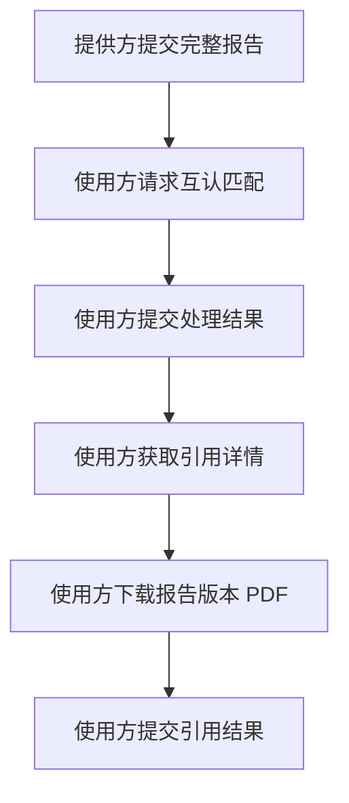
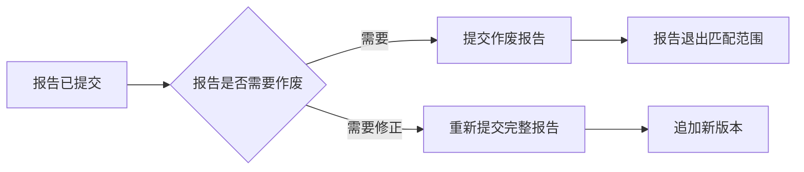

<!-- cover -->
编制单位：待确认（由部署方与接入方在交付前确认后填写）

| 项目 | 内容 |
| --- | --- |
| 文档名称 | 检查检验结果互认平台第三方接入接口规范 |
| 文档版本 | 0.1.0 |
| 编制日期 | 2026-11-05 |
| 文档状态 | 待审查 |
| 适用范围 | 接入检查检验结果互认平台的第三方系统：医院侧报告采集服务、医院 HIS 及同类集成系统 |
| 接口范围 | 已发布的业务接口 9 个（9 条 HTTP 路由）：报告管理接口 4 个、互认业务接口 4 个、报告文件接口 1 个；另有待确认接口 1 个 |

本文中的组织、医院、院区、患者、科室、医务人员、报告和项目标识均为格式示例。实际取值由部署方与接入双方在联调时确认。本文不包含登录认证材料；配套认证资料的取得方式见第 4 章。

<!-- pagebreak -->

## 修订记录

| 版本 | 修订日期 | 修订内容 | 编制 |
| --- | --- | --- | --- |
| 0.1.0 | 2026-11-05 | 首次编制。在接口文档初稿基础上按接入规范体例重写全文，覆盖概述、适用范围、术语、接入准备与身份认证、通信与数据约定、业务流程与接口总览、报告管理接口、互认业务接口、报告文件接口、数据字典与联调异常处理。 | 待确认 |

修订记录只登记本规范自身的版本变更。接口行为的变更依据为平台实现与联调确认结果；未取得确认前，不在本表登记推测性改动。

<!-- pagebreak -->

## 目录

<!-- toc -->

<!-- chapter -->

# 1 概述

## 1.1 编制目的

本规范说明第三方系统接入检查检验结果互认平台（以下简称“平台”）时可调用的业务接口、报文字段、调用前置条件、返回结果、失败口径与重复调用行为，使接入方在不阅读平台源码的前提下完成接口开发、自测与联调。

本规范以平台当前的接口实现为依据编制。规范中的字段名称、数据类型、必填要求、枚举取值与响应结构均与实现一致；实现尚未确认的行为一律标注为待确认，不写成确定结论。本规范不描述平台内部的领域模型、数据表结构与事务实现。

## 1.2 与接口文档的关系

平台此前发布的《检查检验结果互认平台第三方接口文档》是本规范的编制依据之一。本规范在其基础上做了四项调整：

1. 按接入规范体例重排章节，每个接口固定采用“接口说明、请求地址与通信信息、请求参数、请求示例、响应参数、响应示例、校验与异常说明、重复调用与重试”八个部分，便于逐项比对和评审。
2. 补齐字段的中文名称、类型与格式、可空性以及省略、null、空串、空集合四类取值口径，使参数表可直接用于报文校验。
3. 将公共枚举、公共对象与文件约定集中到数据字典和通信约定章节，接口章节只引用、不重复定义。
4. 将未实现或尚未确认的能力显式标注为待确认，不写成可交付接口。

接口文档与本规范冲突时，以本规范为准；本规范与平台实际实现冲突时，以平台实现为准，并应回写修订本规范。

## 1.3 规范性质

本规范是约定，不是实现说明，也不是验收结论。以下事项不在本规范范围内：

- 不替代接口联调。本规范描述的行为来自实现与既有验证证据，未覆盖实际环境下的端到端调用验证。
- 不替代登录认证材料。Token 的取得方式、平台地址与接入参数由部署方以配套认证资料交付，本规范只说明携带方式与身份口径，见第 4 章。
- 不构成平台向第三方的业务推送或回调约定。本规范所列接口全部由第三方主动调用；平台不向第三方推送业务事件。
- 不声明性能指标、可用性指标与容量承诺。

## 1.4 编制依据

| 类别 | 依据 |
| --- | --- |
| 接口实现 | 平台服务端的公开应用服务契约、报告文件控制器与 OpenAPI 文档 |
| 业务口径 | 项目的需求规约与领域接口模型 |
| 编制依据文档 | 平台此前发布的《检查检验结果互认平台第三方接口文档》 |
| 体例参考 | 《四川省健康档案云服务平台应用接口规范》的章节组织与参数呈现方式（仅参考组织与呈现形式，不引用其业务规则） |

<!-- pagebreak -->

# 2 适用范围

## 2.1 适用对象

本规范适用于接入平台内部署环境的以下调用方：

| 调用方 | 典型系统 | 承担职责 |
| --- | --- | --- |
| 医院侧报告采集服务 | 检验信息系统（LIS）、医学影像信息系统（PACS/RIS）、报告采集与上报中间件 | 向平台提交完整检验报告与检查报告及其 PDF 文件；报告需要作废时提交作废请求 |
| 医院 HIS | 门急诊与住院医生工作站、电子病历系统及院内集成平台 | 在开单或接诊环节请求互认匹配、提交互认处理结果、获取互认引用详情、下载报告 PDF、提交引用结果 |

同一家医院可以同时承担上述两个角色。两类角色可使用同一应用身份，也可按院区或系统分别申请应用身份；实际划分由部署方与接入方在联调前确认。

## 2.2 适用范围边界

1. 本规范只覆盖第三方主动调用的业务接口，不覆盖登录、Token 签发与刷新。
2. 本规范不覆盖平台页面功能接口，包括标准项目目录维护、互认项目配置维护、金额维护、统计查询与导出等仅面向平台操作人员的接口。
3. 本规范不覆盖平台内部集成接口，包括组织与人员服务、权限服务、参数维护接口。
4. 同一接口的请求与响应字段以本规范列出的为准。调用方只应提交参数表列出的字段；平台对未列出字段的处理按各接口章节的说明执行，调用方不得依赖未列出的字段完成对接。

## 2.3 接入级别

| 级别 | 含义 |
| --- | --- |
| 必接 | 完成该业务角色最小可用链路所必须实现的接口 |
| 按需接入 | 业务需要时选用；未选用的接口不影响最小可用链路 |
| 待确认 | 实现或对外交付条件尚未确认，接入方不得按本规范编码；确认后另行发布 |

## 2.4 接入前置条件

接入方在同一环境中调用本规范任一接口前，应同时具备以下条件：

1. 已取得部署方提供的服务基础地址，且该地址可访问。
2. 已取得配套认证资料，并能够取得携带组织、医院、院区上下文的有效应用令牌。
3. 已确认本系统的组织编码、医院编码与院区编码，以及平台侧登记的应用标识。
4. 已确认患者证件类型代码与本院实际使用的取值。
5. 已取得当前院区有效的互认项目编码清单，或确认本系统只提交报告、不参与互认匹配。

第 5 项在平台侧提供查询互认项目配置能力前，由部署方以清单或配置页面方式提供。

<!-- chapter -->

# 3 术语和缩略语

## 3.1 术语

| 术语 | 英文或代码名 | 说明 |
| --- | --- | --- |
| 平台 | Medical Recognition Platform | 检查检验结果互认平台，为本规范所有接口的提供方 |
| 检查检验结果互认 | mutual recognition of examination and laboratory results | 医疗机构之间在诊疗过程中互相认可对方已出具的检验、检查报告及其项目结果 |
| 互认项目 | recognition item | 平台标准项目目录中纳入互认范围的项目。第三方在报文中以标准项目编码（standardProjectCode）引用 |
| 标准项目编码 | standard project code | 互认项目的唯一编码，是请求匹配、报告明细互认标识与配置引用的公共键 |
| 来源报告 | source report | 由提供方医院出具并提交到平台的报告。平台按组织、医院、院区、报告类型与来源报告单号组成业务键定位 |
| 报告版本 | report version | 一份报告的一次完整提交内容。报告每次成功提交追加一个版本，其中一个版本为当前版本 |
| 当前有效版本 | current effective version | 报告最新成功提交并置为当前的版本。报告作废后不再作为可匹配版本 |
| 报告生命周期状态 | report lifecycle status | 报告在平台中的状态：有效、已作废。作废不可逆 |
| 提供方组织 / 医院 / 院区 | source organization / hospital / branch | 出具报告并提交到平台的机构。响应中以 source 前缀字段返回 |
| 使用方组织 / 医院 / 院区 | requesting organization / hospital / branch | 调用接口的机构，取自调用身份，不出现在请求体中 |
| 可信调用身份 | trusted calling identity | 平台根据访问令牌解析出的调用方上下文，包含组织、医院、院区与操作人。请求体不得提交、伪造或覆盖其中的字段 |
| 互认匹配记录 | recognition match record | 一次请求互认匹配的调用在平台形成的一条记录，标识为 recognitionMatchRecordId |
| 互认匹配项 | recognition match item | 匹配记录内一个可互认项目实例，标识为 recognitionMatchItemId。处理结果与引用结果均以该标识定位 |
| 处理结果 | recognition processing result | 医生对一个互认匹配项作出的采纳或不采纳决定 |
| 引用结果 | recognition reference result | 互认项目被实际写入病历的事实登记 |
| 引用详情 | citation detail | 平台按患者证件与本次就诊返回的、仍可写入病历的已采纳项目及其报告公共上下文 |
| 业务标识与名称成对 | paired identifier and name | 科室、医务人员等业务主体的标识与名称必须同时有值或同时为空 |
| 零值时间 | zero-valued time | 0001-01-01 类的默认时间。平台视为缺失，不接受零值时间作为业务时间 |
| 修正与作废 | correction and void | 报告内容修正采用重新提交完整报告追加版本；报告作废采用作废接口，二者不混用 |

## 3.2 缩略语

| 缩略语 | 全称 | 说明 |
| --- | --- | --- |
| API | Application Programming Interface | 应用编程接口 |
| HIS | Hospital Information System | 医院信息系统，本规范中指医院侧业务系统 |
| LIS | Laboratory Information System | 检验信息系统 |
| PACS / RIS | Picture Archiving and Communication System / Radiology Information System | 医学影像存档与通信系统 / 放射信息系统 |
| EMR | Electronic Medical Record | 电子病历系统 |
| IAM | Identity and Access Management | 统一身份与访问管理系统，提供本规范所需的访问令牌与调用身份上下文 |
| JSON | JavaScript Object Notation | 报文正文的数据格式 |
| GUID / UUID | Globally Unique Identifier / Universally Unique Identifier | 全局唯一标识，报文中以 36 字符标准文本表示 |
| HTTP / HTTPS | Hypertext Transfer Protocol / HTTP Secure | 传输协议；生产环境使用 HTTPS |
| ISO 8601 | — | 日期与时间的国际标准表示法，本规范的时间字段按此格式传输 |
| UTC | Coordinated Universal Time | 协调世界时 |
| PDF | Portable Document Format | 报告文件格式，本规范中的报告文件只接受 PDF |
| LOINC | Logical Observation Identifiers Names and Codes | 检验项目国际编码体系，作为来源报告的可选字段提交，平台不解析、不换算 |

<!-- chapter -->

# 4 接入准备与身份认证

## 4.1 服务地址

平台业务接口的统一入口形式为：

    {BASE_URL}{接口路径}

BASE_URL 由部署方按环境提供：联调环境与生产环境分别提供各自的 HTTPS 地址。本规范不固定任何环境地址，接口章节中的路径均为相对路径。调用方应按环境配置 BASE_URL，不得在代码中硬编码接入方以外的地址。

生产环境必须使用部署方提供的 HTTPS 地址。HTTP 地址只可能出现在受限的联调环境中，且应以部署方书面说明为前提。

## 4.2 认证方式

1. 第三方必须使用平台部署方确认可用的**应用访问令牌**调用业务接口，不得使用 IAM 用户登录令牌直接调用业务接口。
2. 令牌通过 HTTP 请求头传递，格式固定为：

| 请求头 | 值格式 | 说明 |
| --- | --- | --- |
| Authorization | Bearer <access-token> | 令牌与 Bearer 之间为一个半角空格。请求头名称大小写不敏感，本规范统一写作 Authorization |

3. 令牌缺失、格式错误、无效或已过期时，接口调用失败，不执行业务逻辑。
4. 请求体、查询参数、路径参数均不得承载令牌，也不得承载调用方组织、医院、院区或操作人字段。

## 4.3 调用身份与数据范围

平台从访问令牌解析可信调用身份，并以此确定数据范围：

| 身份要素 | 作用 | 调用方是否提交 |
| --- | --- | --- |
| 组织、医院、院区 | 定位调用方机构，决定可访问的报告、匹配记录与配置数据范围 | 否，由平台解析 |
| 操作人 | 标记本次写入的操作人 | 否，由平台写入 |
| 业务角色（申请、检验、检查、审核、互认、引用科室与人员） | 由请求体成对提交的标识与名称表达，随业务数据保存 | 是，按接口参数表提交 |

数据范围规则：

1. 报告、报告版本、匹配记录、匹配项与引用事实均按组织的业务编码、医院的业务编码、院区的业务编码三级归属。三个编码中任一不同，均属于不同归属。
2. 请求与响应均不包含调用方自己的组织、医院、院区编码字段。响应中出现的 source 前缀字段描述提供方机构，receiver 前缀字段描述使用方机构，二者都是业务参与方，不是当前登录人。
3. 平台不校验业务角色标识与名称是否存在于平台的权限系统。权限系统负责菜单与接口授权，业务角色的标识与名称按请求内容保存。
4. 目标数据不属于当前调用身份的可访问范围时，接口调用失败。调用方不得通过提交其他机构的编码扩大数据范围。

## 4.4 令牌取得方式

平台业务接口不签发令牌。第三方的令牌取得路径如下：

\u0060\u0060\u0060mermaid
flowchart LR
  A[“IAM 登录”] --> B[“选择工作身份”]
  B --> C[“换取应用令牌”]
  C --> D[“携带 Bearer 调用业务接口”]
\u0060\u0060\u0060

1. 使用部署方登记的账号登录 IAM 服务。
2. 选定具备目标组织、医院、院区范围的工作身份。用户登录令牌不携带租户与组织上下文，直接用作 Bearer 调用业务接口会被判定为未选择工作身份而失败。
3. 通过 IAM 应用上下文令牌签发接口换取应用令牌，应用标识取本项目在部署环境中的登记值，该令牌携带租户与组织上下文。
4. 业务请求携带该应用令牌作为 Bearer 令牌。

下列事实在本文编制时尚未确认，接入前必须由部署方提供，本规范不给出推测值：

| 待确认事项 | 说明 |
| --- | --- |
| 配套认证资料的位置与名称 | 承载令牌签发步骤与接入参数的资料名称、交付位置和版本 |
| IAM 服务地址与令牌签发接口路径 | 与平台业务地址分属不同服务，不共用 BASE_URL |
| 应用标识（applicationCode） | 本项目在部署环境中的应用登记编码 |
| 令牌有效期、续期与失效处理 | 有效期时长、续期方式、失效后的失败表现 |
| 登录方式与凭据发放 | 账号、凭据与初始授权范围的发放方式 |

在取得上述资料前，接入方不应编写针对令牌签发的调用代码；业务接口的报文与字段开发可先行完成。

## 4.5 认证失败的处理

| 情形 | 表现 | 处理建议 |
| --- | --- | --- |
| 未携带 Authorization 请求头 | 接口调用失败 | 检查客户端是否保留了请求头；检查网关、代理是否剥离请求头 |
| 令牌格式错误 | 接口调用失败 | 按 Bearer <access-token> 校正格式，注意只有一个空格 |
| 令牌无效、已过期或已撤销 | 接口调用失败 | 重新取得令牌后重试；不得把过期令牌写入日志或工单 |
| 令牌缺少组织、医院或院区上下文 | 接口调用失败 | 确认已按第 4.4 节换取应用令牌，而不是直接使用登录令牌 |
| 目标数据不在当前身份范围内 | 接口调用失败 | 确认调用的组织、医院、院区范围，必要时由部署方调整授权；不得改为提交其他机构编码 |

平台不保证固定的错误响应 JSON 结构，也不提供业务错误码。调用方应以接口调用是否成功作为结果判定依据，并按第 11 章登记排查所需信息。

## 4.6 凭据安全要求

1. 令牌只保存在服务端，不写入前端页面、移动端包体、共享日志、工单和截图。
2. 不在多人共用的运维终端中长期保存令牌；按部署方要求定期轮换。
3. 令牌泄露或疑似泄露时，应立即按部署方流程撤销并重新签发。
4. 患者证件号码、联系电话、诊断信息、报告内容与报告 PDF 不得写入普通日志、异常堆栈或链路追踪文本。
5. 生产环境与非生产环境使用不同的应用身份与令牌，不混用。

<!-- chapter -->

# 5 通信与数据约定

## 5.1 传输协议

| 项目 | 约定 |
| --- | --- |
| 协议 | 生产环境使用 HTTPS；联调环境以部署方提供为准 |
| 请求方法 | 各接口章节声明的 HTTP 方法，不使用方法重载或语义替换（例如不以 POST 模拟 GET） |
| 字符编码 | UTF-8 |
| 请求头 Content-Type | JSON 接口为 application/json；文件上传接口为 multipart/form-data；无请求体的查询接口不带请求体 |
| 响应头 Content-Type | JSON 接口为 application/json；文件下载接口为 application/pdf |
| 超时与连接 | 由接入方按自身网络条件配置；平台不承诺固定的响应时间上限 |

## 5.2 请求与响应格式

1. JSON 接口的请求体是单个 JSON 对象。请求体必须存在，且必须是合法 JSON；空请求体、纯空白请求体或 JSON 数组作为请求体均导致调用失败。
2. 无业务字段的接口提交空对象 \{\}，不提交 null 或空串。
3. 成功响应为 JSON 值时，响应体是该 JSON 值本身，不包裹在 data、result 之类的信封对象中。
4. 文件上传接口使用 multipart/form-data，部件名称固定，见第 7 章。
5. 文件下载接口的响应体为文件流，不使用 JSON。
6. 平台不保证固定的失败响应 JSON 结构，也不定义业务错误码。调用方不得按 code、message 等字段解析失败原因，也不得依赖 HTTP 状态码的具体取值区分业务失败类型。

## 5.3 字段命名

1. JSON 字段名使用小写开头的 camelCase，例如 identityDocumentNo、standardProjectCode。
2. 平台按大小写不敏感的方式读取字段，但公开约定为 camelCase。调用方应按 camelCase 提交，不得依赖其他写法。
3. 数组元素字段呈现在数组字段之下，参数表中写作 数组字段名[].子字段名 的形式，用于表达嵌套路径；实际报文中的数组元素不再包一层与数组字段同名的对象。
4. 调用方只应提交参数表列出的字段。报告提交文档（第 7.1 节、第 7.2 节的 reportJson）对未列出字段的拒绝有实现依据，且同样作用于嵌套对象与数组元素；其余接口对未列出字段的处理尚未取得证据，不得按“会被忽略”或“必然失败”任一种假设编码，详见第 11.4 节。
5. 平台不提供字段别名。修改字段名之前的写法不保证被接受。

## 5.4 字段取值状态

参数表中的必填要求使用以下取值口径。四类取值状态在同一字段上的含义互不相同：

| 取值状态 | 报文表现 | 说明 |
| --- | --- | --- |
| 省略 | 对象中不存在该字段名 | 按该字段的默认值处理：声明为可省略的集合字段按空数组处理，声明为应填的字段按缺失处理；必填字段缺失即失败 |
| null | 字段存在，值为 JSON null | 仅在字段允许为空时被接受；必填字段传 null 与缺失同判，即失败 |
| 空串 | 字段存在，值为长度为零的字符串 | 必填文本字段传空串即失败；应填文本字段传空串按无业务值处理，调用方应直接省略或传 null，不用空串代替缺失 |
| 空集合 | 字段存在，值为 [] | 仅在声明允许为空的集合字段上成立；要求至少一个元素的集合字段传空数组即失败。集合字段不应传 null |

必填要求的含义：

| 必填要求 | 含义 |
| --- | --- |
| 必填 | 必须提供有效值。缺失、传 null、空串、纯空白或零值时间均导致整次失败 |
| 应填 | 来源系统存在该信息时必须提供；确实不存在时允许省略或传 null。已提供时应满足该字段的格式与取值约束 |
| 条件应填 | 在指定业务条件成立时按应填要求执行；条件不成立时允许省略或传 null |
| 条件必填 | 在指定业务条件成立时必须提供有效值 |
| 成对 | 两个字段应同时有值或同时为空。允许为空的成对字段可同时省略或同时传 null |
| 可空 | 该字段允许返回 null 或允许提交 null，按所在参数表的类型列与说明列判断 |

其他规则：

字符串的规范形式与保存行为按下列三个环节区分，三者不能互相替代：

| 环节 | 处理 | 说明 |
| --- | --- | --- |
| 调用方填写 | 按参数表要求填写，并自行提交去除首尾空白后的值 | 不依赖平台侧代为处理；必填字段提交纯空白等同未提供 |
| 患者定位与比较 | 按 5.4.1 节逐字段执行，不对全部字段统一处理 | 各字段是否取规范形式、取哪种规范形式，按该字段参与的业务定位与比较环节决定 |
| 报告版本与来源内容 | 按来源提交的原值保存 | 报告版本中的姓名、证件号码、就诊流水号、科室与人员标识及各类来源文本均保留来源原值，不因定位时的规范化而改写 |

调用方的填写要求：

1. 应自行去除待提交字符串的首尾空白后再提交，不要依赖平台侧处理。
2. 证件号码提交时不转换大小写不影响定位结果，因为平台在定位与比较时统一为大写；报告版本中保存的是来源原值，因此核对历史版本内容时应按来源提交的写法比对。
3. 平台不把空串、null 与“0”、“0001-01-01T00:00:00” 之类的占位值视为业务值。业务时间必须传真实发生时间。
4. 集合字段的元素必须是 JSON 对象。元素为 null、字符串或数组时绑定失败。
5. 平台只对自己有实现依据的环节取规范形式；其余比较与相等判断按字段原值进行，不得按本规范的个别规范化处理推断其他字段会被统一去空白、替换字符或转换大小写。

### 5.4.1 字符串比较与规范形式

各环节对字符串的处理如下，未列出的字段一律按原值比较：

- **患者标识与定位**：证件类型代码、证件号码与患者姓名在患者定位与比较时去除首尾空白；证件号码同时统一为大写。这三项是平台唯一按规范形式定位的字符串。
- **拟开标准项目编码**：匹配查询中，拟开项目集合的标准项目编码去除首尾空白后去重，并按该值查找互认配置与定位候选报告。
- **就诊与其他标识按原值**：就诊类型、就诊流水号，以及各类机构、科室与人员标识（含互认科室标识、互认医生标识、引用科室标识、引用医生标识），在比较与相等判断时按字段原值进行，不先去空白；前后空白不同会被判定为不同事实，并可能返回冲突。
- **来源明细标识判重**：普通检验结果与药敏结果的来源明细标识在同一范围内判重时，先去首尾空白再比较，纯空白按未提供处理。
- **幂等与重试**：参与冲突判定与幂等比较的字段，重试时必须按首次提交的原值、原样提交。填写的差异（包括首尾空白或大小写不同）会被判定为事实不一致并返回冲突，即使该字段在患者定位环节会被规范化。
- **报告版本与来源内容**：按来源提交的原值保存。

报告版本中的科室与人员标识及名称、来源项目名称与结果原文、检查所见与检查结论，以及作废原因与不采纳补充说明，均按来源原值保存。

## 5.5 数据类型表示

| 参数表中的类型 | 报文中的表示 | 说明与约束 |
| --- | --- | --- |
| string | JSON 字符串 | 按接口说明与参数表填写；取值格式与保存行为见 5.4 节。平台只为已声明的字段设置长度限制；参数表未声明长度限制的字段，平台不另行设定，调用方不得据此推算其他字段的上限 |
| string(date-time) | JSON 字符串，ISO 8601 日期时间 | 应带时区偏移，例如 2026-11-01T10:00:00+08:00。零值时间按缺失处理 |
| integer | JSON 整数 | 不接受小数、字符串形式的数字或枚举名称 |
| number | JSON 数值 | 金额类字段；未配置时返回 null，调用方按零元处理 |
| boolean | JSON 布尔值 | true 或 false，不接受 “true”、“1” 之类的字符串或数字表示 |
| object | JSON 对象 | 字段清单见对应参数表 |
| array<object> | JSON 数组，元素为对象 | 元素字段清单见对应参数表 |
| Guid | JSON 字符串，标准 UUID 文本 | 例如 3fa85f64-5717-4562-b3fc-2c963f66afa6。必填标识传全零 Guid 即失败 |
| file | multipart 文件部件 | 见第 7.1.2 节的文件校验规则 |

## 5.6 枚举

1. 枚举字段在报文中提交整数，不提交枚举名称，也不提交字符串形式的整数（例如 “1”）。
2. 未在本规范数据字典中列出的整数值均无效，接口调用失败。
3. 平台在响应中提供的中文文本字段（字段名以 Text 结尾，例如 reportTypeText）只用于展示，不参与请求提交，调用方不得回传。
4. 诊断为“其他”类的取值（例如就诊类型的其他、不采纳原因的其他情形确需复查）按对应接口要求提交说明字段。

公共枚举集中列示在 10.1 节。

## 5.7 时间

1. 所有业务时间字段以 ISO 8601 日期时间字符串传输，必须代表真实发生时间。
2. 调用方应提交带时区偏移的时间。不提供偏移时，平台按服务端本地时区解释，接入方不应依赖该行为。
3. 时间顺序校验的边界含两端。例如“不晚于本次请求接收时间”表示等于接收时间成立。
4. 平台接收时间由服务端生成，调用方不提交，也不参与请求字段校验。
5. 涉及的时间顺序规则在对应接口章节列出。未列出的时间字段不受顺序校验。

## 5.8 金额

1. 金额由平台按使用方院区当前配置计算，调用方不提交金额字段。
2. 采纳决定形成预计节省金额。未配置金额的互认项目按零元计算。
3. 响应中的金额字段为数值类型，未配置时为 null。

## 5.9 空结果与失败的表现

不同接口在无业务数据时的表现不同，按接口声明的类型区分：

| 响应类型 | 无业务数据时的表现 |
| --- | --- |
| 布尔响应 | 成功返回 true；本规范所列写接口均不返回 false |
| 对象响应 | 按接口说明返回对象；部分接口在无可用数据时按原因拒绝，不返回空对象 |
| 数组响应 | 返回空数组 []；不含任何有效元素的分类或分组不返回 |
| 文件流响应 | 返回文件流；定位失败时按原因拒绝 |

失败一律通过接口调用失败表达，调用方不得把失败响应转换为布尔 false、空对象或空数组后继续业务。

## 5.10 分页与数据量

本规范所列接口均不分页，一次调用返回满足条件的全部数据。匹配查询按患者证件与本次就诊的范围返回报告与项目；引用详情按有效期返回仍可引用的项目。

接口返回的数据量由业务范围决定。接入方应按业务规模评估单次请求与响应的报文大小，并自行设置客户端超时与重试策略。

## 5.11 并发与顺序

1. 同一报告单号下的多次报告提交按平台接收顺序追加版本。平台不按源端报告修改时间决定版本先后。
2. 同一匹配记录的处理结果按整组提交。并发提交同一组的不同决定时，先落库的事实有效，后到的提交按事实不一致处理。
3. 平台不提供跨接口的事务。调用方应保证业务顺序：先匹配、再提交处理结果、获取引用详情、下载报告文件、最后提交引用结果。

## 5.12 字符与内容

1. 文本按 UTF-8 传输与保存。
2. 报告正文内容（检查所见、检查结论、来源结果原文等）按来源原文提交，平台不解析、不换算、不重新判定。
3. 影像调阅地址由提供方医院给出，平台不代理、不缓存，也不保证该地址可用。
4. 上传与下载的文件只支持 PDF，规则见第 9 章。
5. 报文中的示例值均为格式示例，不得作为生产取值。

<!-- chapter -->

# 6 业务流程与接口总览

## 6.1 角色与接口

平台在互认业务中的参与方分为报告提供方与报告使用方。同一家医院可以同时承担两个角色：

| 参与方 | 系统 | 使用接口 |
| --- | --- | --- |
| 报告提供方 | 医院侧报告采集服务 | 提交完整检验报告、提交完整检查报告、作废检验报告、作废检查报告 |
| 报告使用方 | 医院 HIS | 请求互认匹配、提交互认处理结果、获取互认引用详情、提交互认引用结果、下载报告版本 PDF |

## 6.2 主流程

报告提供方提交报告，报告使用方在开单或接诊环节请求匹配、作出决定、写入病历并反馈引用事实：



流程说明：

1. 提交完整报告：报告提供方在报告出具后提交完整报告内容与 PDF。平台按报告业务键创建报告或追加版本。
2. 请求互认匹配：报告使用方按患者证件与本次就诊提交拟开标准项目，平台返回当前可互认的报告、项目与主要结果。
3. 提交处理结果：医生对本次匹配的每个项目作出采纳或不采纳决定后，按匹配记录整组提交。
4. 获取引用详情：病历书写环节按患者证件与本次就诊取回仍可引用的已采纳项目及其报告公共上下文。
5. 下载报告版本 PDF：需要报告原件时，按引用详情或匹配结果返回的报告标识与报告版本标识下载。
6. 提交引用结果：引用内容实际写入病历后，提交引用事实。

报告作废是在提交报告之后的独立分支：



## 6.3 接口总览

下表的编号在全文通用。接口章节标题、错误排查记录与联调清单均引用该编号。

| 编号 | 接入级别 | 接口名称 | 方法 | 路径 | 调用方 |
| --- | --- | --- | --- | --- | --- |
| 1 | 必接 | 提交完整检验报告 | POST | /api/v1/report-pdf/laboratory-report | 报告提供方（采集服务） |
| 2 | 必接 | 提交完整检查报告 | POST | /api/v1/report-pdf/examination-report | 报告提供方（采集服务） |
| 3 | 必接 | 作废检验报告 | POST | /Api/MedicalRecognitionReport/VoidLaboratoryReport | 报告提供方（采集服务） |
| 4 | 必接 | 作废检查报告 | POST | /Api/MedicalRecognitionReport/VoidExaminationReport | 报告提供方（采集服务） |
| 5 | 必接 | 请求互认匹配 | POST | /Api/MedicalRecognitionReport/RequestRecognitionMatches | 报告使用方（HIS） |
| 6 | 必接 | 提交互认处理结果 | POST | /Api/MedicalRecognitionReport/SubmitRecognitionProcessingResults | 报告使用方（HIS） |
| 7 | 必接 | 提交互认引用结果 | POST | /Api/MedicalRecognitionReport/SubmitRecognitionReferences | 报告使用方（HIS） |
| 8 | 必接 | 获取互认引用详情 | POST | /Api/MedicalRecognitionReportQuery/QueryRecognitionCitationDetail | 报告使用方（HIS） |
| 9 | 必接 | 下载报告版本 PDF | GET | /api/v1/report-pdf/\{reportId\}/versions/\{reportVersionId\}/pdf | 报告使用方（HIS） |
| 10 | 待确认 | 查询互认项目配置 | POST | /Api/MedicalRecognitionReportQuery/QueryRecognitionProjectConfigurationList（对外契约待确认） | 报告使用方（HIS） |

说明：

1. 接口 1、2、9 使用带版本前缀的固定路由；接口 3 至 8 使用平台按应用服务名与动作名推导的路由，形如 /Api/应用服务名/动作名。表中路径为已确认的实际路由，接入方应按本表路径调用，不按推导规则自行拼接。
2. 接口 9 的路径参数为报告标识与报告版本标识，均为标准 UUID 文本。
3. 接口 10 的实现与对外交付条件尚未确认，见 6.4 节。

## 6.4 未发布接口

### 6.4.1 查询互认项目配置

平台已按框架规则发布路由 POST /Api/MedicalRecognitionReportQuery/QueryRecognitionProjectConfigurationList，该路由面向平台内部管理场景：请求需要提交组织编码，且取值必须与调用身份的组织一致。其对外契约（字段、必填要求、响应结构）与第三方授权口径尚未确认；既有接口文档此前将该接口标注为待实现。

因此本规范不把该接口列为第三方可调用接口。路径先行公开是为了避免接入方按推导规则猜测其他路径，这不构成对外契约；接入方不得按该路由编码，也不得按内部管理契约推断字段。

平台发布该接口的对外契约前，接入方通过下列方式取得互认项目编码：

1. 向部署方索取当前院区有效的互认项目编码清单。
2. 使用平台页面查询互认项目配置，由平台操作人员导出或核对后提供给接入方。

平台发布该接口的对外契约后，本规范将按第 7 章的同一模板补充接口章节，并同步更新 6.3 节与数据字典。

## 6.5 接口之间的标识引用

标识的传递关系是联调中最易出错的部分，按下表传递：

| 来源 | 标识 | 后续用途 |
| --- | --- | --- |
| 提交报告（接口 1、2） | 来源报告单号（reportNo） | 作废报告时定位报告 |
| 请求互认匹配（接口 5） | 互认匹配记录标识（recognitionMatchRecordId） | 提交处理结果时定位整组匹配 |
| 请求互认匹配（接口 5） | 互认匹配项标识（recognitionMatchItemId） | 提交处理结果的组成项、提交引用结果时定位项目 |
| 请求互认匹配（接口 5） | 报告标识与报告版本标识 | 下载报告版本 PDF |
| 获取引用详情（接口 8） | 互认匹配项标识 | 提交引用结果时定位项目 |
| 获取引用详情（接口 8） | 报告标识与报告版本标识 | 下载报告版本 PDF |

报告标识与报告版本标识必须成对使用：下载接口按两者共同定位版本，报告版本不属于该报告时调用失败。互认匹配项标识与互认匹配记录标识不得跨患者、跨就诊或跨机构复用。

## 6.6 调用顺序与状态前置条件

各接口对前置状态的要求如下，未满足前置状态时调用失败：

| 接口 | 前置状态 |
| --- | --- |
| 3、4 作废报告 | 报告已存在且属于当前调用身份范围；报告已作废时按第 7.3.8 节处理 |
| 5 请求互认匹配 | 拟开标准项目编码在标准目录中有效，且已纳入当前组织的互认配置并处于启用状态 |
| 6 提交处理结果 | 匹配记录存在且属于当前调用身份；匹配记录绑定的报告版本仍为当前有效版本 |
| 7 提交引用结果 | 匹配项存在；该匹配项已有采纳的处理结果；引用时间不早于已保存的互认时间 |
| 8 获取引用详情 | 本次就诊在该医院、院区与证件下存在已采纳且在有效期内的记录 |
| 9 下载报告版本 PDF | 报告版本属于该报告，且报告在当前调用身份的组织与医院范围内 |

<!-- chapter -->

# 7 报告管理接口

本章说明报告提供方使用的四个接口。接口 1 与接口 2 的报文结构除报告类型专项内容外完全一致，第 7.2 节只列出与第 7.1 节的差异项。

## 7.1 提交完整检验报告

### 7.1.1 接口说明

医院侧报告采集服务通过本接口提交一份完整检验报告，包括公共版本信息、检验专项内容、普通检验结果、细菌鉴定及药敏结果，以及报告 PDF 文件。结构化报告内容与对应 PDF 应描述同一份报告。

平台根据当前调用身份所属组织、医院、院区，以及报告类型和来源报告单号定位报告。报告不存在时创建报告及首个版本；报告已存在且有效时追加完整版本，并将新版本设为当前版本。已作废报告拒绝追加版本。

调用前应取得有效 Bearer Token，并具备可解析的组织、医院、院区及操作人身份。组织、医院、院区和操作人由平台从可信调用身份确定。科室和医务人员业务标识及名称由来源系统填写，按请求保存。

每次提交均应携带完整内容。平台不按源端报告修改时间决定版本先后，也不按报告内容判重。报告更新时应再次提交完整报告及 PDF。

### 7.1.2 请求地址与通信信息

| 项目 | 内容 |
| --- | --- |
| 调用方 | 医院侧报告采集服务 |
| 请求方法 | POST |
| 接口路径 | /api/v1/report-pdf/laboratory-report |
| 请求格式 | multipart/form-data；boundary 由 HTTP 客户端生成 |
| 响应格式 | application/json；成功响应体为布尔值 true |
| 文本编码 | UTF-8 |
| 身份认证 | Authorization: Bearer <access-token> |

完整请求地址为部署方提供的服务基础地址与本接口路径的组合。本文示例中的 BASE_URL 与 ACCESS_TOKEN 应替换为接入环境确认的实际值。

### 7.1.3 请求参数

填报要求：“必填”表示必须提供有效值；“应填”表示来源系统存在该信息时应提供，确实不存在时允许为空；“条件应填”表示在指定业务条件下遵循应填要求；“条件必填”表示条件成立时必须提供有效值。成对字段应同时有值；允许为空的成对字段也可同时为空。

JSON 字段使用 camelCase。日期时间以 ISO 8601 字符串传输，例如 2026-11-01T10:00:00+08:00。枚举使用整数；不得使用枚举名称或字符串形式的数字。报告 JSON 及其嵌套结构拒绝未列出的字段（有实现依据，见 5.3 节）。没有明细时集合字段应写为 []，不要传 null；允许省略的集合字段省略时按空数组处理；数组元素必须为有效对象。

请求头

| 参数名称 | 中文名称 | 类型／格式 | 必填要求 | 说明与约束 |
| --- | --- | --- | --- | --- |
| Authorization | 访问令牌 | string | 必填 | 格式为 Bearer <access-token>，见 4.2 节。 |

multipart 顶层部件

| 参数名称 | 中文名称 | 类型／格式 | 必填要求 | 说明与约束 |
| --- | --- | --- | --- | --- |
| reportJson | 完整报告 JSON 文档 | string | 必填 | 文本部件，内容为下列结构的完整 JSON 对象。 |
| pdfFile | 报告 PDF 文件 | file | 必填 | 文件部件 Content-Type 为 application/pdf；扩展名为 .pdf；非空且文件头为 %PDF-。 |

multipart 仅提交 reportJson 与 pdfFile 两个顶层部件。reportJson 中不得添加组织编码、医院编码、院区编码、平台内部主键、文件键、存储路径或下载地址。当前单文件默认上限为 83 886 080 字节（80 MB），取自平台配置节 ReportPdfFiles 的 MaxFileBytes 项；实际接入时应向部署方确认当前部署的取值。

reportJson 顶层对象

| 参数名称 | 中文名称 | 类型／格式 | 必填要求 | 说明与约束 |
| --- | --- | --- | --- | --- |
| reportNo | 来源报告单号 | string | 必填 | 在同一组织、医院、院区及报告类型内定位报告。 |
| version | 公共版本信息 | object | 必填 | 对象字段见下表。 |
| content | 检验专项内容 | object | 必填 | 对象字段见下表。 |
| results | 普通检验结果集合 | array<object> | 必填 | 至少一条；元素字段见 results[]。 |
| bacteriaResults | 细菌鉴定结果集合 | array<object> | 应填 | 无细菌鉴定结果时使用 []；省略时按空数组处理。 |

公共版本信息 reportJson.version

| 参数名称 | 中文名称 | 类型／格式 | 必填要求 | 说明与约束 |
| --- | --- | --- | --- | --- |
| sourceReportName | 来源报告名称 | string | 必填 | 不得缺失、传 null、空串或纯空白。 |
| patientName | 患者姓名 | string | 必填 | 来源患者姓名；调用方应去除首尾空白；报告版本按来源原值保存，见 5.4 节。 |
| patientGenderCode | 患者性别代码 | string | 必填 | 按来源系统性别代码填写。 |
| patientBirthDate | 患者出生日期 | string(date-time) | 必填 | ISO 8601 日期时间；不得使用零值时间。 |
| patientPhoneNumber | 患者联系电话 | string | 应填 | 来源存在时应提供；确实不存在时允许省略或传 null。 |
| ageAtReport | 报告时年龄 | string | 应填 | 按来源文本填写，例如 46岁。 |
| identityDocumentTypeCode | 证件类型代码 | string | 必填 | 调用方应去除首尾空白；患者定位时平台去除首尾空白后使用，报告版本按来源原值保存。 |
| identityDocumentNo | 证件号码 | string | 必填 | 调用方应去除首尾空白；患者定位时平台去除首尾空白并统一为大写使用，报告版本按来源原值保存。 |
| visitType | 就诊类型 | integer | 必填 | 1 门诊；2 急诊；3 住院；4 体检；5 其他。其他仅用于无法归入前四类的特殊就诊。 |
| visitSerialNo | 就诊流水号 | string | 必填 | 不得缺失、传 null、空串或纯空白。 |
| inpatientNo | 住院号 | string | 条件应填 | 住院时，来源存在该信息应提供；其他情况允许省略或传 null。 |
| wardName | 病区名称 | string | 条件应填 | 住院时，来源存在该信息应提供；其他情况允许省略或传 null。 |
| roomName | 病房名称 | string | 条件应填 | 住院时，来源存在该信息应提供；其他情况允许省略或传 null。 |
| bedNo | 床位号 | string | 条件应填 | 住院时，来源存在该信息应提供；其他情况允许省略或传 null。 |
| applicationDeptId | 申请科室标识 | string | 必填 | 来源系统业务标识；与对应名称同时提供。 |
| applicationDeptName | 申请科室名称 | string | 必填 | 与对应标识同时提供。 |
| applicationDoctorId | 申请医生标识 | string | 必填 | 来源系统业务标识；与对应名称同时提供。 |
| applicationDoctorName | 申请医生名称 | string | 必填 | 与对应标识同时提供。 |
| executionDeptId | 执行科室标识 | string | 必填 | 来源系统业务标识；与对应名称同时提供。 |
| executionDeptName | 执行科室名称 | string | 必填 | 与对应标识同时提供。 |
| reportDeptId | 报告科室标识 | string | 必填 | 来源系统业务标识；与对应名称同时提供。 |
| reportDeptName | 报告科室名称 | string | 必填 | 与对应标识同时提供。 |
| reportDoctorId | 报告医生标识 | string | 必填 | 来源系统业务标识；与对应名称同时提供。 |
| reportDoctorName | 报告医生名称 | string | 必填 | 与对应标识同时提供。 |
| reviewDoctorId | 审核医生标识 | string | 必填 | 来源系统业务标识；与对应名称同时提供。 |
| reviewDoctorName | 审核医生名称 | string | 必填 | 与对应标识同时提供。 |
| applicationTime | 申请时间 | string(date-time) | 必填 | 不得晚于报告时间；不得使用零值时间。 |
| reportTime | 报告时间 | string(date-time) | 必填 | 不得晚于平台接收时间；提供审核时间时不得晚于审核时间。 |
| reviewTime | 审核时间 | string(date-time) | 应填 | 来源存在时提供；省略或传 null 时不参与时间顺序校验，提供时不得为零值。 |
| sourceModifiedTime | 源端报告修改时间 | string(date-time) | 必填 | 随版本保存，用于来源追溯；不参与版本顺序判断，不得使用零值时间。 |
| sourceConfidentialFlag | 来源保密标识 | string | 应填 | 来源存在时应提供；确实不存在时允许省略或传 null。 |

检验专项内容 reportJson.content

| 参数名称 | 中文名称 | 类型／格式 | 必填要求 | 说明与约束 |
| --- | --- | --- | --- | --- |
| reportCategoryCode | 报告类别编码 | string | 应填 | 来源存在时应提供；确实不存在时允许省略或传 null。 |
| reportCategoryName | 报告类别名称 | string | 应填 | 来源存在时应提供；确实不存在时允许省略或传 null。 |
| reportRemark | 报告备注 | string | 应填 | 来源存在时应提供；确实不存在时允许省略或传 null。 |
| overallAbnormalFlag | 整体异常标识 | string | 应填 | 按来源系统原值提供，平台不重新计算。 |
| sourceOrderSerialNo | 来源医嘱流水号 | string | 应填 | 来源存在时应提供；确实不存在时允许省略或传 null。 |
| specimenCollectedTime | 标本采集时间 | string(date-time) | 应填 | 来源存在时应提供；确实不存在时允许省略或传 null。 |
| specimenSubmittedTime | 标本送检时间 | string(date-time) | 应填 | 来源存在时应提供；确实不存在时允许省略或传 null。 |
| laboratoryReceivedTime | 检验科接收时间 | string(date-time) | 应填 | 来源存在时应提供；确实不存在时允许省略或传 null。 |
| sourceSpecimenNo | 院内标本号 | string | 必填 | 不得缺失、传 null、空串或纯空白。 |
| specimenTypeCode | 标本类型编码 | string | 必填 | 不得缺失、传 null、空串或纯空白。 |
| specimenTypeName | 标本类型名称 | string | 必填 | 不得缺失、传 null、空串或纯空白。 |
| testingCompletedTime | 检测完成时间 | string(date-time) | 必填 | ISO 8601 日期时间；不得使用零值时间。 |
| inspectorId | 检验人标识 | string | 必填 | 与 inspectorName 同时提供。 |
| inspectorName | 检验人名称 | string | 必填 | 与 inspectorId 同时提供。 |

普通检验结果元素 reportJson.results[]

| 参数名称 | 中文名称 | 类型／格式 | 必填要求 | 说明与约束 |
| --- | --- | --- | --- | --- |
| sourceDetailKey | 来源明细标识 | string | 应填 | 提供时，同一版本的普通检验结果中不得重复；比较前去除首尾空白。 |
| sourceProjectName | 来源项目名称 | string | 必填 | 不得缺失、传 null、空串或纯空白。 |
| sourceProjectCode | 来源项目编码 | string | 应填 | 来源存在时应提供；确实不存在时允许省略或传 null。 |
| standardProjectCode | 互认项目编码 | string | 应填 | 缺失或当前不可用不影响接收，但不形成相应匹配资格。 |
| sourceResultText | 来源结果原文 | string | 必填 | 不得缺失、传 null、空串或纯空白。 |
| resultType | 结果类型 | integer | 必填 | 1 数值型；2 定性型；3 文本型。 |
| loincCode | LOINC 编码 | string | 应填 | 来源存在时应提供；确实不存在时允许省略或传 null。 |
| unit | 单位 | string | 应填 | 来源存在时应提供；确实不存在时允许省略或传 null。 |
| referenceRange | 参考范围 | string | 应填 | 来源存在时应提供；确实不存在时允许省略或传 null。 |
| testingMethod | 检测方法 | string | 应填 | 来源存在时应提供；确实不存在时允许省略或传 null。 |
| instrumentCode | 检测仪器编码 | string | 应填 | 来源存在时应提供；确实不存在时允许省略或传 null。 |
| instrumentName | 检测仪器名称 | string | 应填 | 来源存在时应提供；确实不存在时允许省略或传 null。 |
| displayOrder | 展示序号 | integer | 必填 | 正整数；同一版本的普通检验结果中不得重复。 |
| abnormalFlag | 异常标志 | integer | 应填 | 允许省略或传 null；提供时仅接受 1 正常、2 偏高、3 偏低、4 其他异常。 |
| criticalValueFlag | 危急值标志 | boolean | 应填 | true 表示危急值，false 表示非危急值；来源没有该信息时允许省略或传 null。 |
| laboratoryChargeItemCode | 检验收费项目编码 | string | 应填 | 来源存在时应提供；确实不存在时允许省略或传 null。 |
| medicalInsuranceChargeItemCode | 医保收费项目编码 | string | 应填 | 来源存在时应提供；确实不存在时允许省略或传 null。 |
| inspectorId | 检测人标识 | string | 应填 | 与 inspectorName 同时有值或同时为空。 |
| inspectorName | 检测人名称 | string | 应填 | 与 inspectorId 同时有值或同时为空。 |

细菌鉴定结果元素 reportJson.bacteriaResults[]

| 参数名称 | 中文名称 | 类型／格式 | 必填要求 | 说明与约束 |
| --- | --- | --- | --- | --- |
| sourceDetailKey | 来源明细标识 | string | 应填 | 按来源值保存，平台不做唯一性校验。 |
| sourceOrganismCode | 来源菌种编码 | string | 应填 | 来源存在时应提供；确实不存在时允许省略或传 null。 |
| sourceOrganismName | 来源菌种名称 | string | 条件必填 | detectionConclusion 去除首尾空白后等于“未检出”时允许为空；其他结论必须提供。 |
| sourceResultText | 来源结果原文 | string | 必填 | 不得缺失、传 null、空串或纯空白。 |
| detectionConclusion | 检测结论 | string | 必填 | 培养未检出时仍提交一条结果，填写“未检出”。 |
| colonyCount | 菌落计数 | string | 应填 | 来源存在时应提供；确实不存在时允许省略或传 null。 |
| cultureMedium | 培养基 | string | 应填 | 来源存在时应提供；确实不存在时允许省略或传 null。 |
| cultureTime | 培养时间 | string | 应填 | 来源存在时应提供；确实不存在时允许省略或传 null。 |
| cultureCondition | 培养条件 | string | 应填 | 来源存在时应提供；确实不存在时允许省略或传 null。 |
| discoveryMethod | 发现方式 | string | 应填 | 来源存在时应提供；确实不存在时允许省略或传 null。 |
| detectionMethod | 检测方法 | string | 应填 | 来源存在时应提供；确实不存在时允许省略或传 null。 |
| description | 详细描述 | string | 应填 | 来源存在时应提供；确实不存在时允许省略或传 null。 |
| instrumentCode | 检测仪器编码 | string | 应填 | 来源存在时应提供；确实不存在时允许省略或传 null。 |
| instrumentName | 检测仪器名称 | string | 应填 | 来源存在时应提供；确实不存在时允许省略或传 null。 |
| testPanelCode | 试验板编码 | string | 应填 | 来源存在时应提供；确实不存在时允许省略或传 null。 |
| testPanelName | 试验板名称 | string | 应填 | 来源存在时应提供；确实不存在时允许省略或传 null。 |
| inspectorId | 检测人标识 | string | 应填 | 与 inspectorName 同时有值或同时为空。 |
| inspectorName | 检测人名称 | string | 应填 | 与 inspectorId 同时有值或同时为空。 |
| susceptibilities | 药敏结果集合 | array<object> | 应填 | 没有药敏结果时使用 []；省略时按空数组处理。 |

药敏结果元素 reportJson.bacteriaResults[].susceptibilities[]

| 参数名称 | 中文名称 | 类型／格式 | 必填要求 | 说明与约束 |
| --- | --- | --- | --- | --- |
| sourceDetailKey | 来源明细标识 | string | 应填 | 提供时，同一细菌鉴定结果下不得重复；比较前去除首尾空白。 |
| drugCode | 受试药物编码 | string | 应填 | 来源存在时应提供；确实不存在时允许省略或传 null。 |
| drugName | 受试药物名称 | string | 必填 | 不得缺失、传 null、空串或纯空白。 |
| susceptibilityCode | 药敏结论编码 | string | 应填 | 来源存在时应提供；确实不存在时允许省略或传 null。 |
| sourceConclusionText | 来源结论 | string | 必填 | 不得缺失、传 null、空串或纯空白。 |
| resistanceResultCode | 抗药结果编码 | string | 应填 | 来源存在时应提供；确实不存在时允许省略或传 null。 |
| diskContent | 纸片含药量 | string | 应填 | 按来源文本保存。 |
| micValue | 最低抑菌浓度 | string | 应填 | 按来源文本整串保存，平台不解析。 |
| inhibitionZoneDiameter | 抑菌环直径 | string | 应填 | 按来源文本保存。 |
| referenceValue | 参考值 | string | 应填 | 来源存在时应提供；确实不存在时允许省略或传 null。 |
| displayOrder | 展示序号 | integer | 必填 | 正整数；同一细菌鉴定结果下不得重复。 |
| inspectorId | 检测人标识 | string | 应填 | 与 inspectorName 同时有值或同时为空。 |
| inspectorName | 检测人名称 | string | 应填 | 与 inspectorId 同时有值或同时为空。 |
| testingMethod | 检测方法 | string | 应填 | 来源存在时应提供；确实不存在时允许省略或传 null。 |
| testPanelOrder | 试验板序号 | string | 应填 | 来源存在时应提供；确实不存在时允许省略或传 null。 |

### 7.1.4 请求示例

下列数据仅用于说明报文格式。患者、人员、科室、报告和项目标识均为示例值。部署地址、访问令牌、证件类型代码及互认项目编码应使用接入环境确认的值。

将下列完整 JSON 保存为 laboratory-report.json；将同一报告的 PDF 保存为 laboratory-report.pdf，随后通过 HTTP 客户端提交两个部件。

```bash
curl --request POST "${BASE_URL}/api/v1/report-pdf/laboratory-report" \
  --header "Authorization: Bearer ${ACCESS_TOKEN}" \
  --form "reportJson=<laboratory-report.json;type=text/plain;charset=utf-8" \
  --form "pdfFile=@laboratory-report.pdf;type=application/pdf"
```

此命令使用 Bash 续行语法。使用其他客户端时，按相同的部件名称、部件内容和内容类型构造请求；Content-Type 中的 boundary 由客户端自动生成。

reportJson 部件内容：

```json
{
  "reportNo": "LAB-20261101-001",
  "version": {
    "sourceReportName": "尿液检验报告",
    "patientName": "示例患者",
    "patientGenderCode": "1",
    "patientBirthDate": "1980-01-01T00:00:00+08:00",
    "patientPhoneNumber": null,
    "ageAtReport": "46岁",
    "identityDocumentTypeCode": "01",
    "identityDocumentNo": "ID-EXAMPLE-001",
    "visitType": 1,
    "visitSerialNo": "VISIT-20261101-001",
    "inpatientNo": null,
    "wardName": null,
    "roomName": null,
    "bedNo": null,
    "applicationDeptId": "DEPT-001",
    "applicationDeptName": "门诊内科",
    "applicationDoctorId": "DOC-001",
    "applicationDoctorName": "示例申请医生",
    "executionDeptId": "DEPT-LAB",
    "executionDeptName": "检验科",
    "reportDeptId": "DEPT-LAB",
    "reportDeptName": "检验科",
    "reportDoctorId": "DOC-LAB-001",
    "reportDoctorName": "示例报告医生",
    "reviewDoctorId": "DOC-LAB-002",
    "reviewDoctorName": "示例审核医生",
    "applicationTime": "2026-11-01T08:00:00+08:00",
    "reportTime": "2026-11-01T10:00:00+08:00",
    "reviewTime": "2026-11-01T10:10:00+08:00",
    "sourceModifiedTime": "2026-11-01T10:10:00+08:00",
    "sourceConfidentialFlag": null
  },
  "content": {
    "reportCategoryCode": null,
    "reportCategoryName": null,
    "reportRemark": null,
    "overallAbnormalFlag": null,
    "sourceOrderSerialNo": null,
    "specimenCollectedTime": "2026-11-01T08:30:00+08:00",
    "specimenSubmittedTime": "2026-11-01T08:35:00+08:00",
    "laboratoryReceivedTime": "2026-11-01T08:40:00+08:00",
    "sourceSpecimenNo": "SP-20261101-001",
    "specimenTypeCode": "SPECIMEN-URINE",
    "specimenTypeName": "尿液",
    "testingCompletedTime": "2026-11-01T09:30:00+08:00",
    "inspectorId": "TECH-001",
    "inspectorName": "示例检验人员"
  },
  "results": [
    {
      "sourceDetailKey": "DETAIL-001",
      "sourceProjectName": "尿白细胞计数",
      "sourceProjectCode": "LOCAL-URINE-WBC",
      "standardProjectCode": null,
      "sourceResultText": "5",
      "resultType": 1,
      "loincCode": null,
      "unit": "个/μL",
      "referenceRange": null,
      "testingMethod": null,
      "instrumentCode": null,
      "instrumentName": null,
      "displayOrder": 1,
      "abnormalFlag": null,
      "criticalValueFlag": null,
      "laboratoryChargeItemCode": null,
      "medicalInsuranceChargeItemCode": null,
      "inspectorId": null,
      "inspectorName": null
    }
  ],
  "bacteriaResults": []
}
```

本例 standardProjectCode 为 null，用于展示来源没有互认编码的情形：报告可以接收，但该明细不形成互认匹配资格。需要参与互认时，应填写实际有效的互认项目编码。

细菌鉴定及药敏结果示例：存在相关结果时，可按下列结构填写 bacteriaResults 数组。应同时提供该报告所要求的普通检验结果，results 至少一条的要求仍然适用。

```json
[
  {
    "sourceDetailKey": "BACTERIA-20261101-001",
    "sourceOrganismCode": "ORG-EXAMPLE-001",
    "sourceOrganismName": "示例菌种",
    "sourceResultText": "检出示例菌种",
    "detectionConclusion": "检出",
    "colonyCount": "10^5 CFU/mL",
    "cultureMedium": "血平板",
    "cultureTime": "24小时",
    "cultureCondition": "35℃ 需氧",
    "discoveryMethod": "培养",
    "detectionMethod": "仪器法",
    "description": null,
    "instrumentCode": "INS-EXAMPLE-001",
    "instrumentName": "示例鉴定仪",
    "testPanelCode": "PANEL-EXAMPLE-001",
    "testPanelName": "示例试验板",
    "inspectorId": "TECH-002",
    "inspectorName": "示例微生物检验人员",
    "susceptibilities": [
      {
        "sourceDetailKey": "AST-20261101-001",
        "drugCode": "DRUG-EXAMPLE-001",
        "drugName": "示例受试药物",
        "susceptibilityCode": "S",
        "sourceConclusionText": "敏感",
        "resistanceResultCode": null,
        "diskContent": "10μg",
        "micValue": null,
        "inhibitionZoneDiameter": null,
        "referenceValue": null,
        "displayOrder": 1,
        "inspectorId": null,
        "inspectorName": null,
        "testingMethod": "纸片扩散法",
        "testPanelOrder": "1"
      }
    ]
  }
]
```

培养未检出时，bacteriaResults 数组仍应包含一条表达未检出的结果，例如：

```json
[
  {
    "sourceResultText": "培养未检出",
    "detectionConclusion": "未检出",
    "sourceOrganismName": null,
    "susceptibilities": []
  }
]
```

### 7.1.5 响应参数

| 响应内容 | 类型 | 说明 |
| --- | --- | --- |
| 响应体 | boolean | 成功固定返回 true；本接口不返回 false，也不返回报告标识、版本标识或文件地址。 |

成功表示本次完整报告提交完成。接口失败通过 HTTP 调用失败及平台失败响应表达；调用方不得将失败响应解释为布尔值 false。

### 7.1.6 响应示例

成功响应体如下：

```json
true
```

### 7.1.7 校验与异常说明

身份与报文：Token 无效、调用身份无法解析、multipart 必需部件缺失、reportJson 不是合法 JSON、字段类型错误或出现未知字段时，请求失败。

文件：PDF 为空、超过部署环境单文件上限、内容类型不为 application/pdf、扩展名不为 .pdf、文件头不为 %PDF- 时，请求失败。

业务字段：必填文本为空或纯空白，必填时间缺失或使用零值，标识和名称未成对提供，或者就诊类型、结果类型、异常标志超出规定取值时，整份报告提交失败。

业务时间：申请时间不得晚于报告时间；报告时间不得晚于平台接收时间；提供审核时间时，报告时间不得晚于审核时间。

明细：results 至少一条；普通结果的展示序号应为正整数且在同一版本内唯一。普通结果的非空来源明细标识在同一版本内唯一。每条细菌鉴定结果中的药敏展示序号应为正整数且唯一；非空药敏来源明细标识也应唯一。

细菌鉴定：检测结论和来源结果原文均必填。检测结论去除首尾空白后等于“未检出”时，来源菌种名称允许为空；其他结论下必须提供来源菌种名称。每条药敏结果的受试药物名称、来源结论及展示序号必填。

报告归属：报告已作废、患者身份冲突、将已有报告改为其他患者归属，或出现并发唯一性冲突时，请求失败。

业务提交失败时不保存部分报告业务数据，既有报告版本保持原有状态。平台对本次上传文件执行失败补偿；接入方应保留来源报告及必要的调用记录，以便排查提交结果。Token、患者证件号码、联系电话、报告内容及 PDF 不得写入普通日志。

失败响应由平台统一处理。本接口不约定固定的错误 JSON 结构或业务错误码；排查时应提供调用时间、接口路径、来源报告单号以及平台返回的请求追踪信息（如有）。

### 7.1.8 重复调用与重试

本接口不按内容判重。同一报告单号下，每次成功调用都会追加完整新版本，并将新版本设为当前版本。即使两次提交的 JSON 和 PDF 完全相同，也会产生两个版本。

收到明确的校验或业务失败响应后，应处理失败原因再提交。发生超时、连接中断等无法确认最终结果的情况时，应核实报告接收状态；直接重试可能追加版本。

源端报告修改时间仅用于来源追溯。较早的源端修改时间再次成功提交，也会按本次接收顺序追加版本。调用方应控制同一报告的发送顺序和重复发送。

## 7.2 提交完整检查报告

### 7.2.1 接口说明

医院侧报告采集服务通过本接口提交一份完整检查报告，包括公共版本信息、检查专项内容、检查项目与检查部位，以及报告 PDF 文件。结构化报告内容与对应 PDF 应描述同一份报告。

报告定位、版本追加、身份口径、事务边界与失败补偿口径与 7.1 节一致，差异仅在于报告类型按检查报告处理、报文按检查结构解析。检查所见与检查结论按来源原文提交，平台不解析、不重新判定。影像调阅地址由提供方医院给出，平台不代理、不缓存。

### 7.2.2 请求地址与通信信息

| 项目 | 内容 |
| --- | --- |
| 调用方 | 医院侧报告采集服务 |
| 请求方法 | POST |
| 接口路径 | /api/v1/report-pdf/examination-report |
| 请求格式 | multipart/form-data；boundary 由 HTTP 客户端生成 |
| 响应格式 | application/json；成功响应体为布尔值 true |
| 文本编码 | UTF-8 |
| 身份认证 | Authorization: Bearer <access-token> |

### 7.2.3 请求参数

请求头与 multipart 顶层部件（Authorization、reportJson、pdfFile）的字段、类型、必填要求与校验规则与 7.1.3 节完全相同，本节不再重复列出。

reportJson 顶层对象

| 参数名称 | 中文名称 | 类型／格式 | 必填要求 | 说明与约束 |
| --- | --- | --- | --- | --- |
| reportNo | 来源报告单号 | string | 必填 | 在同一组织、医院、院区及报告类型内定位报告。 |
| version | 公共版本信息 | object | 必填 | 字段与 7.1.3 节的 version 完全一致，不因报告类型不同而变化。 |
| content | 检查专项内容 | object | 必填 | 对象字段见下表。 |
| items | 检查项目集合 | array<object> | 必填 | 至少一条；元素字段见 items[]。 |

公共版本信息 reportJson.version

字段清单、类型、必填要求与校验规则与 7.1.3 节的“公共版本信息 reportJson.version”一致，包含 sourceReportName 至 sourceConfidentialFlag 共 31 个字段。本节不重复列出。

检查专项内容 reportJson.content

| 参数名称 | 中文名称 | 类型／格式 | 必填要求 | 说明与约束 |
| --- | --- | --- | --- | --- |
| sourceExaminationTypeCode | 来源检查类型编码 | string | 应填 | 来源存在时应提供；确实不存在时允许省略或传 null。 |
| sourceExaminationTypeName | 来源检查类型名称 | string | 应填 | 来源存在时应提供；确实不存在时允许省略或传 null。 |
| reportRemark | 报告备注 | string | 应填 | 来源存在时应提供；确实不存在时允许省略或传 null。 |
| overallAbnormalFlag | 整体异常标识 | string | 应填 | 按来源系统原值提供，平台不重新计算。 |
| findings | 检查所见 | string | 必填 | 完整原文；不得缺失、传 null、空串或纯空白。 |
| conclusion | 检查结论 | string | 必填 | 完整原文；不得缺失、传 null、空串或纯空白。 |
| conditionDescription | 病情描述 | string | 应填 | 来源存在时应提供；确实不存在时允许省略或传 null。 |
| examinationPurpose | 检查目的 | string | 应填 | 来源存在时应提供；确实不存在时允许省略或传 null。 |
| sourceDiagnosisCode | 来源诊断编码 | string | 应填 | 来源存在时应提供；确实不存在时允许省略或传 null。 |
| sourceDiagnosisName | 来源诊断名称 | string | 必填 | 不得缺失、传 null、空串或纯空白。 |
| examinationTime | 实际检查时间 | string(date-time) | 必填 | ISO 8601 日期时间；不得使用零值时间。 |
| examinerId | 检查医生标识 | string | 必填 | 来源系统业务标识；与 examinerName 同时提供。 |
| examinerName | 检查医生名称 | string | 必填 | 与 examinerId 同时提供。 |
| sourceImageStatus | 来源影像状态 | integer | 应填 | 1 有影像；2 无影像；3 未知。未提供时按未知处理。 |
| imageAccessUrl | 影像调阅地址 | string | 可空 | 来源影像状态为无影像（2）时必须为空。 |
| examinationMethod | 检查方法 | string | 应填 | 来源存在时应提供；确实不存在时允许省略或传 null。 |
| deviceCode | 设备编码 | string | 应填 | 来源存在时应提供；确实不存在时允许省略或传 null。 |
| deviceName | 设备名称 | string | 应填 | 来源存在时应提供；确实不存在时允许省略或传 null。 |

检查项目元素 reportJson.items[]

| 参数名称 | 中文名称 | 类型／格式 | 必填要求 | 说明与约束 |
| --- | --- | --- | --- | --- |
| sourceProjectName | 来源项目名称 | string | 必填 | 不得缺失、传 null、空串或纯空白。 |
| sourceProjectCode | 来源项目编码 | string | 应填 | 来源存在时应提供；确实不存在时允许省略或传 null。 |
| standardProjectCode | 互认项目编码 | string | 应填 | 缺失或当前不可用不影响接收，但不形成相应匹配资格。 |
| sites | 检查部位集合 | array<object> | 应填 | 项目没有明确部位时使用 []；省略时按空数组处理；元素字段见 sites[]。 |

检查部位元素 reportJson.items[].sites[]

| 参数名称 | 中文名称 | 类型／格式 | 必填要求 | 说明与约束 |
| --- | --- | --- | --- | --- |
| sourceSiteCode | 来源部位编码 | string | 应填 | 来源存在时应提供；确实不存在时允许省略或传 null。 |
| siteName | 部位名称 | string | 必填 | 不得缺失、传 null、空串或纯空白。 |

### 7.2.4 请求示例

将下列完整 JSON 保存为 examination-report.json；将同一报告的 PDF 保存为 examination-report.pdf，随后提交两个部件。

```bash
curl --request POST "${BASE_URL}/api/v1/report-pdf/examination-report" \
  --header "Authorization: Bearer ${ACCESS_TOKEN}" \
  --form "reportJson=<examination-report.json;type=text/plain;charset=utf-8" \
  --form "pdfFile=@examination-report.pdf;type=application/pdf"
```

reportJson 部件内容：

```json
{
  "reportNo": "EXAM-20261101-001",
  "version": {
    "sourceReportName": "胸部CT平扫报告",
    "patientName": "示例患者",
    "patientGenderCode": "1",
    "patientBirthDate": "1980-01-01T00:00:00+08:00",
    "patientPhoneNumber": null,
    "ageAtReport": "46岁",
    "identityDocumentTypeCode": "01",
    "identityDocumentNo": "ID-EXAMPLE-001",
    "visitType": 1,
    "visitSerialNo": "VISIT-20261101-001",
    "inpatientNo": null,
    "wardName": null,
    "roomName": null,
    "bedNo": null,
    "applicationDeptId": "DEPT-001",
    "applicationDeptName": "门诊内科",
    "applicationDoctorId": "DOC-001",
    "applicationDoctorName": "示例申请医生",
    "executionDeptId": "DEPT-RAD",
    "executionDeptName": "放射科",
    "reportDeptId": "DEPT-RAD",
    "reportDeptName": "放射科",
    "reportDoctorId": "DOC-RAD-001",
    "reportDoctorName": "示例报告医生",
    "reviewDoctorId": "DOC-RAD-002",
    "reviewDoctorName": "示例审核医生",
    "applicationTime": "2026-11-01T08:10:00+08:00",
    "reportTime": "2026-11-01T11:00:00+08:00",
    "reviewTime": "2026-11-01T11:20:00+08:00",
    "sourceModifiedTime": "2026-11-01T11:20:00+08:00",
    "sourceConfidentialFlag": null
  },
  "content": {
    "sourceExaminationTypeCode": "EXAMTYPE-CT",
    "sourceExaminationTypeName": "CT检查",
    "reportRemark": null,
    "overallAbnormalFlag": null,
    "findings": "两肺纹理清晰，未见明确实变影；心影大小形态未见异常；纵隔居中，未见肿大淋巴结。",
    "conclusion": "胸部CT平扫未见明显异常。",
    "conditionDescription": null,
    "examinationPurpose": "排查肺部感染",
    "sourceDiagnosisCode": null,
    "sourceDiagnosisName": "发热，未特指",
    "examinationTime": "2026-11-01T09:00:00+08:00",
    "examinerId": "TECH-R-001",
    "examinerName": "示例检查技师",
    "sourceImageStatus": 1,
    "imageAccessUrl": "https://pacs.example.com/view/EXAM-20261101-001",
    "examinationMethod": "平扫",
    "deviceCode": "DEV-CT-001",
    "deviceName": "示例CT设备"
  },
  "items": [
    {
      "sourceProjectName": "胸部CT平扫",
      "sourceProjectCode": "LOCAL-CT-CHEST",
      "standardProjectCode": "EXAM-CT-CHEST",
      "sites": [
        {
          "sourceSiteCode": "SITE-CHEST",
          "siteName": "胸部"
        }
      ]
    }
  ]
}
```

本例 sourceImageStatus 为 1（有影像），因此 imageAccessUrl 允许提供。来源没有影像时，sourceImageStatus 应为 2 且 imageAccessUrl 必须为空；无法确定时传 3。

### 7.2.5 响应参数

| 响应内容 | 类型 | 说明 |
| --- | --- | --- |
| 响应体 | boolean | 成功固定返回 true；本接口不返回 false，也不返回报告标识、版本标识或文件地址。 |

### 7.2.6 响应示例

```json
true
```

### 7.2.7 校验与异常说明

与 7.1.7 节同一规则，差异项如下：

1. 报文按检查结构解析，检查专项内容与检查项目字段按 7.2.3 节校验。
2. items 至少一条；每条检查项目的部位名称必填，来源部位编码可空。
3. 来源影像状态不是 1、2、3 之一时，请求失败。
4. 来源影像状态为无影像（2）而影像调阅地址非空时，请求失败。
5. 实际检查时间不得为零值时间。

### 7.2.8 重复调用与重试

与 7.1.8 节相同：不按内容判重，每次成功调用在同一报告单号下追加完整新版本。

## 7.3 作废检验报告

### 7.3.1 接口说明

报告提供方按来源报告单号作废一份检验报告。作废只改变报告的生命周期状态，同时登记作废时间与作废原因；不删除数据，不可恢复。

组织、医院、院区由可信调用身份确定，报告类型由所调用的接口确定为检验报告。本次请求的接收时间由服务端取，用于校验作废时间不晚于请求接收时点。已作废报告不再参与互认匹配，但其历史版本 PDF 仍可下载。

### 7.3.2 请求地址与通信信息

| 项目 | 内容 |
| --- | --- |
| 调用方 | 医院侧报告采集服务 |
| 请求方法 | POST |
| 接口路径 | /Api/MedicalRecognitionReport/VoidLaboratoryReport |
| 请求格式 | application/json; charset=utf-8 |
| 响应格式 | application/json；成功响应体为布尔值 true |
| 文本编码 | UTF-8 |
| 身份认证 | Authorization: Bearer <access-token> |

### 7.3.3 请求参数

请求体为单个 JSON 对象。

| 参数名称 | 中文名称 | 类型／格式 | 必填要求 | 说明与约束 |
| --- | --- | --- | --- | --- |
| reportNo | 来源报告单号 | string | 必填 | 与可信调用身份的组织、医院、院区以及检验报告类型共同定位报告。 |
| voidedTime | 作废时间 | string(date-time) | 必填 | 不早于当前版本平台接收时间，不晚于本次请求接收时间，两端含边界；不得为零值时间。 |
| voidReason | 作废原因 | string | 必填 | 来源系统提供的作废原因文本；不得为空串或纯空白。 |

请求体只应提交上表列出的字段。本接口对未列出字段的处理尚未取得证据，调用方不得依赖平台静默忽略未列出的字段，也不得依赖其必然失败；联调时按第 11.4 节实测确认。

### 7.3.4 请求示例

```bash
curl --request POST "${BASE_URL}/Api/MedicalRecognitionReport/VoidLaboratoryReport" \
  --header "Authorization: Bearer ${ACCESS_TOKEN}" \
  --header "Content-Type: application/json; charset=utf-8" \
  --data-binary @void-laboratory-report.json
```

void-laboratory-report.json 内容：

```json
{
  "reportNo": "LAB-20261101-001",
  "voidedTime": "2026-11-01T15:00:00+08:00",
  "voidReason": "报告内容有误，重新出具"
}
```

### 7.3.5 响应参数

| 响应内容 | 类型 | 说明 |
| --- | --- | --- |
| 响应体 | boolean | 成功作废或命中幂等返回 true；本接口不返回 false。 |

### 7.3.6 响应示例

```json
true
```

### 7.3.7 校验与异常说明

1. 报告单号、作废原因缺失、传 null、空串或纯空白时，请求失败。
2. 作废时间为零值时间时，请求失败。
3. 报告不存在，或报告不属于当前调用身份的组织、医院、院区与检验报告类型时，请求失败。
4. 作废时间早于当前版本的平台接收时间，或晚于本次请求接收时间时，请求失败。
5. 报告已作废，且作废时间与作废原因与本次提交完全一致时，按 7.3.8 节幂等成功。
6. 报告已作废，且作废时间或作废原因与本次提交任一不一致时，返回作废信息冲突；平台不覆盖既有作废事实。

作废失败时不改变报告状态，既有版本保持原有状态。

### 7.3.8 重复调用与重试

本接口按报告作废事实幂等：报告已作废且作废时间、作废原因与本次提交完全一致时幂等成功，返回 true，不重复登记作废事件。

发生超时或连接中断时，应先核实报告状态再决定是否重试。若重试提交的作废事实与首次一致，返回幂等成功；若不一致，返回冲突。调用方不得以不同的作废原因重试以绕过冲突。

## 7.4 作废检查报告

### 7.4.1 接口说明

报告提供方按来源报告单号作废一份检查报告。入参、响应、幂等口径与失败条件与 7.3 节一致，差异仅在于报告类型按检查报告定位。已作废检查报告不再参与互认匹配，其历史版本 PDF 仍可下载。

### 7.4.2 请求地址与通信信息

| 项目 | 内容 |
| --- | --- |
| 调用方 | 医院侧报告采集服务 |
| 请求方法 | POST |
| 接口路径 | /Api/MedicalRecognitionReport/VoidExaminationReport |
| 请求格式 | application/json; charset=utf-8 |
| 响应格式 | application/json；成功响应体为布尔值 true |
| 文本编码 | UTF-8 |
| 身份认证 | Authorization: Bearer <access-token> |

### 7.4.3 请求参数

字段、类型与必填要求与 7.3.3 节完全相同（reportNo、voidedTime、voidReason）。报告类型由本接口确定为检查报告。

### 7.4.4 请求示例

```bash
curl --request POST "${BASE_URL}/Api/MedicalRecognitionReport/VoidExaminationReport" \
  --header "Authorization: Bearer ${ACCESS_TOKEN}" \
  --header "Content-Type: application/json; charset=utf-8" \
  --data-binary @void-examination-report.json
```

void-examination-report.json 内容：

```json
{
  "reportNo": "EXAM-20261101-001",
  "voidedTime": "2026-11-01T15:10:00+08:00",
  "voidReason": "检查报告结论修订，重新出具"
}
```

### 7.4.5 响应参数

| 响应内容 | 类型 | 说明 |
| --- | --- | --- |
| 响应体 | boolean | 成功作废或命中幂等返回 true；本接口不返回 false。 |

### 7.4.6 响应示例

```json
true
```

### 7.4.7 校验与异常说明

与 7.3.7 节同一规则，报告不存在与作废信息冲突两项按检查报告判定。

### 7.4.8 重复调用与重试

与 7.3.8 节相同。

<!-- chapter -->

# 8 互认业务接口

## 8.1 请求互认匹配

### 8.1.1 接口说明

医院 HIS 在接诊或开单环节按患者证件与本次就诊提交拟开的标准项目，平台返回当前可互认的检查检验报告、命中的互认项目及主要结果。

使用方的组织、医院、院区取自可信调用身份，操作人取自登录上下文，调用方均不提交。查询截止点取平台收到本次查询的时间；平台不接收挂号时间、入院时间或统一就诊时间作为截止点。

平台不接收院内项目编码，也不维护院内项目与标准项目的对照。拟开项目一律使用标准项目编码提交，编码必须在标准目录中有效、已纳入当前组织的互认配置且配置处于启用状态，否则整次调用失败。

本院报告匹配开关与本院报告排除时长按平台级参数读取。参数不存在、取值非法或读取失败时整次调用失败。匹配结果不含本院自身出具的、处于排除时长内的报告。接口不分页。

### 8.1.2 请求地址与通信信息

| 项目 | 内容 |
| --- | --- |
| 调用方 | 医院 HIS |
| 请求方法 | POST |
| 接口路径 | /Api/MedicalRecognitionReport/RequestRecognitionMatches |
| 请求格式 | application/json; charset=utf-8 |
| 响应格式 | application/json; charset=utf-8 |
| 文本编码 | UTF-8 |
| 身份认证 | Authorization: Bearer <access-token> |

### 8.1.3 请求参数

| 参数名称 | 中文名称 | 类型／格式 | 必填要求 | 说明与约束 |
| --- | --- | --- | --- | --- |
| identityDocumentTypeCode | 患者证件类型代码 | string | 必填 | 缺失、传 null、空串或纯空白均失败。 |
| identityDocumentNo | 患者证件号码 | string | 必填 | 同上；平台按大写比对。 |
| visitType | 本次来源就诊类型 | integer | 必填 | 1 门诊；2 急诊；3 住院；4 体检；5 其他。 |
| visitSerialNo | 本次来源就诊流水号 | string | 必填 | 与就诊类型共同识别本次就诊。 |
| proposedItems | 拟开标准项目集合 | array<object> | 必填 | 至少一条；同次查询中重复的标准项目编码只处理一次；元素字段见下表。 |

拟开标准项目元素 proposedItems[]

| 参数名称 | 中文名称 | 类型／格式 | 必填要求 | 说明与约束 |
| --- | --- | --- | --- | --- |
| itemType | 项目类型 | integer | 必填 | 0 检验；1 检查。 |
| standardProjectCode | 标准项目编码 | string | 必填 | 缺失、传 null、空串或纯空白均失败；编码必须与项目类型一致且当前可用。 |

请求体只应提交上表列出的字段。本接口对未列出字段的处理尚未取得证据，调用方不得依赖平台静默忽略未列出的字段，也不得依赖其必然失败；联调时按第 11.4 节实测确认。本接口的请求体不提交组织、医院、院区、科室、医生与患者平台标识。

### 8.1.4 请求示例

```bash
curl --request POST "${BASE_URL}/Api/MedicalRecognitionReport/RequestRecognitionMatches" \
  --header "Authorization: Bearer ${ACCESS_TOKEN}" \
  --header "Content-Type: application/json; charset=utf-8" \
  --data-binary @recognition-match-request.json
```

recognition-match-request.json 内容：

```json
{
  "identityDocumentTypeCode": "01",
  "identityDocumentNo": "ID-EXAMPLE-001",
  "visitType": 1,
  "visitSerialNo": "VISIT-20261101-001",
  "proposedItems": [
    {
      "itemType": 0,
      "standardProjectCode": "LAB-CBC"
    },
    {
      "itemType": 1,
      "standardProjectCode": "EXAM-CT-CHEST"
    }
  ]
}
```

### 8.1.5 响应参数

成功返回匹配响应对象。无命中时返回 hasMatches 为 false 的成功结果，不按失败处理。

| 参数名称 | 中文名称 | 类型／格式 | 可空性 | 说明 |
| --- | --- | --- | --- | --- |
| hasMatches | 本次查询是否存在匹配 | boolean | 否 | 无命中时为 false。 |
| recognitionMatchRecordId | 互认匹配记录标识 | Guid | 无命中时为 null | 提交处理结果时定位整组匹配。 |
| matchCreatedTime | 本次匹配生成时间 | string(date-time) | 无命中时为 null | 平台生成，调用方不提交。 |
| reports | 匹配到的报告集合 | array<object> | 无命中时为空集合 | 按报告归并；元素字段见 reports[]。 |

匹配报告元素 reports[]

| 参数名称 | 中文名称 | 类型／格式 | 可空性 | 说明 |
| --- | --- | --- | --- | --- |
| reportId | 报告标识 | Guid | 否 | 下载报告版本 PDF 时使用。 |
| reportVersionId | 报告版本标识 | Guid | 否 | 命中的当前有效版本；下载报告版本 PDF 时使用。 |
| reportType | 报告类型 | integer | 否 | 1 检验报告；2 检查报告。 |
| reportTypeText | 报告类型中文 | string | 否 | 展示用文本，不得回传。 |
| reportNo | 来源报告单号 | string | 否 | 提供方医院的报告单号。 |
| reportName | 来源报告名称 | string | 否 | |
| sourceOrganizationCode | 提供方组织编码 | string | 否 | |
| sourceOrganizationName | 提供方组织名称 | string | 否 | 平台按提供方机构信息回填。 |
| sourceHospitalCode | 提供方医院编码 | string | 否 | |
| sourceHospitalName | 提供方医院名称 | string | 否 | |
| sourceBranchCode | 提供方院区编码 | string | 否 | |
| sourceBranchName | 提供方院区名称 | string | 否 | |
| clinicalTime | 检查或检验时间 | string(date-time) | 否 | 检验报告取检测完成时间，检查报告取实际检查时间。 |
| reportTime | 报告时间 | string(date-time) | 否 | |
| file | PDF 与影像入口 | object | 否 | 字段见 file。 |
| matchItems | 本报告命中的互认项目集合 | array<object> | 未命中项目时为空集合 | 元素字段见 matchItems[]。 |

PDF 与影像入口 reports[].file

| 参数名称 | 中文名称 | 类型／格式 | 可空性 | 说明 |
| --- | --- | --- | --- | --- |
| pdfFileId | PDF 文件标识 | string | 可为空 | 平台保存的文件键；调用方不使用，下载按报告标识与版本标识进行。 |
| pdfDownloadUrl | PDF 下载入口 | string | 可为空 | 相对下载地址，格式为 api/v1/report-pdf/{reportId}/versions/{reportVersionId}/pdf；调用规则见第 9 章。 |
| pdfOriginalFileName | PDF 原始文件名 | string | 可为空 | 上传时保存的下载名。 |
| sourceImageStatus | 来源影像状态 | integer | 检验报告或来源未提供时为空 | 1 有影像；2 无影像；3 未知。 |
| sourceImageStatusText | 来源影像状态中文 | string | 来源未提供时为空 | 展示用文本，不得回传。 |
| imageAccessUrl | 影像调阅地址 | string | 无影像或来源未提供时为空 | 由提供方医院给出的外部信息，平台不代理、不缓存、不保证可用。 |

互认项目元素 reports[].matchItems[]

| 参数名称 | 中文名称 | 类型／格式 | 可空性 | 说明 |
| --- | --- | --- | --- | --- |
| recognitionMatchItemId | 互认匹配项标识 | Guid | 否 | 提交处理结果与提交引用结果的定位依据。 |
| standardProjectCode | 标准项目编码 | string | 否 | 与拟开项目的标准项目编码一致。 |
| standardProjectName | 标准项目名称 | string | 否 | 取平台标准目录中的项目名称。 |
| specimenTypeName | 标本类型名称 | string | 检查项目无业务值 | 检验项目取来源标本类型名称。 |
| laboratoryResults | 主要检验结果明细 | array<object> | 检查项目为空集合 | 元素字段见 laboratoryResults[]。 |
| examinationSites | 检查部位集合 | array<object> | 检验项目为空集合 | 元素字段见 examinationSites[]。 |
| overallAbnormalFlag | 来源报告整体异常标识 | string | 可为空 | 只表达提供方医院的判断，平台不重新计算。 |

检验结果明细 reports[].matchItems[].laboratoryResults[]

| 参数名称 | 中文名称 | 类型／格式 | 可空性 | 说明 |
| --- | --- | --- | --- | --- |
| resultItemName | 检验项目名称 | string | 否 | 按来源原文返回，平台不解析、不换算。 |
| sourceResultContent | 来源结果原文 | string | 否 | |
| unit | 单位 | string | 来源未提供时为空 | |
| sourceReferenceRange | 来源参考范围 | string | 来源未提供时为空 | |
| sourceAbnormalFlag | 来源异常标志 | string | 来源未提供时为空 | 按来源原文返回的文本，不是整数值。 |
| sourceCriticalValueFlag | 来源危急值标志 | string | 来源未提供时为空 | 按来源原文返回的文本。 |

检查部位元素 reports[].matchItems[].examinationSites[]

| 参数名称 | 中文名称 | 类型／格式 | 可空性 | 说明 |
| --- | --- | --- | --- | --- |
| siteName | 部位名称 | string | 否 | |
| sourceSiteCode | 来源部位编码 | string | 来源未提供时为空 | |

### 8.1.6 响应示例

有命中时：

```json
{
  "hasMatches": true,
  "recognitionMatchRecordId": "3fa85f64-5717-4562-b3fc-2c963f66afa6",
  "matchCreatedTime": "2026-11-01T15:30:00+08:00",
  "reports": [
    {
      "reportId": "5b1f0d2e-8a44-4c31-9f77-0c2c8a1b7d10",
      "reportVersionId": "9c2e4a51-6d33-42b8-8e01-7f5a3c9d2b24",
      "reportType": 1,
      "reportTypeText": "检验报告",
      "reportNo": "LAB-20261001-001",
      "reportName": "血常规检验报告",
      "sourceOrganizationCode": "ORG-S",
      "sourceOrganizationName": "示例提供方组织",
      "sourceHospitalCode": "HOSP-S",
      "sourceHospitalName": "示例提供方医院",
      "sourceBranchCode": "BRANCH-S1",
      "sourceBranchName": "示例提供方院区",
      "clinicalTime": "2026-10-01T09:30:00+08:00",
      "reportTime": "2026-10-01T10:00:00+08:00",
      "file": {
        "pdfFileId": "report-pdf-20261001-lab-001",
        "pdfDownloadUrl": "api/v1/report-pdf/5b1f0d2e-8a44-4c31-9f77-0c2c8a1b7d10/versions/9c2e4a51-6d33-42b8-8e01-7f5a3c9d2b24/pdf",
        "pdfOriginalFileName": "血常规检验报告.pdf",
        "sourceImageStatus": null,
        "sourceImageStatusText": null,
        "imageAccessUrl": null
      },
      "matchItems": [
        {
          "recognitionMatchItemId": "7d4b6c18-2f90-4a5e-8b3d-1e6f9a0c5d77",
          "standardProjectCode": "LAB-CBC",
          "standardProjectName": "血常规",
          "specimenTypeName": "全血",
          "laboratoryResults": [
            {
              "resultItemName": "白细胞计数",
              "sourceResultContent": "6.5",
              "unit": "10^9/L",
              "sourceReferenceRange": "3.5-9.5",
              "sourceAbnormalFlag": "正常",
              "sourceCriticalValueFlag": null
            }
          ],
          "examinationSites": [],
          "overallAbnormalFlag": null
        }
      ]
    }
  ]
}
```

无命中时：

```json
{
  "hasMatches": false,
  "recognitionMatchRecordId": null,
  "matchCreatedTime": null,
  "reports": []
}
```

### 8.1.7 校验与异常说明

空结果：患者不存在，或该患者在当前就诊、当前机构范围内没有满足条件的报告时，返回成功空结果，即 hasMatches 为 false、recognitionMatchRecordId 与 matchCreatedTime 为 null、reports 为空集合。空结果不创建匹配记录，也不登记事件。

失败条件：

1. 可信身份不可解析，或操作人不可解析。
2. 证件类型代码、证件号码、就诊流水号缺失或为空白；就诊类型不在 1 至 5 范围内。
3. proposedItems 缺失或为空集合。
4. 本院报告匹配开关或本院报告排除时长参数不存在、取值非法或读取失败。
5. 任一拟开项目的标准项目编码不存在、未纳入当前组织的互认范围、配置已停用、标准目录层级不可用，或与项目类型不一致。
6. 患者证件在校验中出现冲突；匹配记录写入影响行数不为 1。

失败时不创建匹配记录，不登记事件。

### 8.1.8 重复调用与重试

本接口不是幂等接口。每次调用按平台收到时间重新判定，重复调用可能形成新的匹配记录。只读性质的重新查询可以安全执行，但会产生新的匹配记录标识，调用方应以最后一次匹配返回的记录标识提交处理结果。

## 8.2 提交互认处理结果

### 8.2.1 接口说明

医院 HIS 按互认匹配记录整组提交医生作出的采纳或不采纳决定。

使用方的组织、医院、院区与操作人取自可信调用身份，调用方不提交。互认时间、互认科室、互认医生是组级事实，只在组级提供一次。

processingResults 必须完整覆盖该匹配记录内的全部匹配项，不得缺项、重复，也不得夹带属于其他匹配记录的匹配项。任一校验失败时整批不保存。

平台按使用方院区当前配置的金额计算采纳项目的预计节省金额，未配置金额的项目按零元计算。调用方不提交金额字段。

### 8.2.2 请求地址与通信信息

| 项目 | 内容 |
| --- | --- |
| 调用方 | 医院 HIS |
| 请求方法 | POST |
| 接口路径 | /Api/MedicalRecognitionReport/SubmitRecognitionProcessingResults |
| 请求格式 | application/json; charset=utf-8 |
| 响应格式 | application/json；成功响应体为布尔值 true |
| 文本编码 | UTF-8 |
| 身份认证 | Authorization: Bearer <access-token> |

### 8.2.3 请求参数

| 参数名称 | 中文名称 | 类型／格式 | 必填要求 | 说明与约束 |
| --- | --- | --- | --- | --- |
| recognitionMatchRecordId | 互认匹配记录标识 | Guid | 必填 | 全零 Guid 失败；取接口 5 返回的匹配记录标识。 |
| recognitionTime | 互认时间 | string(date-time) | 必填 | 不早于匹配记录生成时间，不晚于本次请求接收时间，两端含边界。 |
| recognitionDeptId | 互认科室标识 | string | 必填 | 缺失、传 null、空串或纯空白均失败。 |
| recognitionDeptName | 互认科室名称 | string | 必填 | 与 recognitionDeptId 成对。 |
| recognitionDoctorId | 互认医生标识 | string | 必填 | 与 recognitionDoctorName 成对。 |
| recognitionDoctorName | 互认医生名称 | string | 必填 | 与 recognitionDoctorId 成对。 |
| processingResults | 组内全部匹配项的决定集合 | array<object> | 必填 | 至少一条，且完整覆盖本组的全部匹配项；元素字段见下表。 |

处理结果元素 processingResults[]

| 参数名称 | 中文名称 | 类型／格式 | 必填要求 | 说明与约束 |
| --- | --- | --- | --- | --- |
| recognitionMatchItemId | 被决定的互认匹配项标识 | Guid | 必填 | 全零 Guid 失败；取接口 5 返回的匹配项标识。 |
| result | 互认结果 | integer | 必填 | 1 采纳；2 不采纳。 |
| nonAdoptionReason | 不采纳原因 | integer | 条件必填 | 不采纳时必填；采纳时不得携带。取值 1 至 6，见 10.1 节。 |
| nonAdoptionDescription | 不采纳补充说明 | string | 条件必填 | 不采纳原因为其他情形确需复查（6）时必填；长度不超过 600 字符。 |

### 8.2.4 请求示例

```bash
curl --request POST "${BASE_URL}/Api/MedicalRecognitionReport/SubmitRecognitionProcessingResults" \
  --header "Authorization: Bearer ${ACCESS_TOKEN}" \
  --header "Content-Type: application/json; charset=utf-8" \
  --data-binary @recognition-processing-result-request.json
```

recognition-processing-result-request.json 内容：

```json
{
  "recognitionMatchRecordId": "3fa85f64-5717-4562-b3fc-2c963f66afa6",
  "recognitionTime": "2026-11-01T15:40:00+08:00",
  "recognitionDeptId": "DEPT-001",
  "recognitionDeptName": "门诊内科",
  "recognitionDoctorId": "DOC-001",
  "recognitionDoctorName": "示例申请医生",
  "processingResults": [
    {
      "recognitionMatchItemId": "7d4b6c18-2f90-4a5e-8b3d-1e6f9a0c5d77",
      "result": 1
    }
  ]
}
```

不采纳的写法如下，nonAdoptionReason 必填；若原因为 6，则 nonAdoptionDescription 同样必填：

```json
{
  "recognitionMatchItemId": "7d4b6c18-2f90-4a5e-8b3d-1e6f9a0c5d77",
  "result": 2,
  "nonAdoptionReason": 1,
  "nonAdoptionDescription": null
}
```

### 8.2.5 响应参数

| 响应内容 | 类型 | 说明 |
| --- | --- | --- |
| 响应体 | boolean | 整批保存成功或命中幂等返回 true；本接口不返回 false。 |

### 8.2.6 响应示例

```json
true
```

### 8.2.7 校验与异常说明

1. 匹配记录不存在，或不属于本次提交的可信组织、医院、院区。
2. processingResults 缺项、重复，或夹带其他匹配记录的匹配项。
3. 互认时间早于匹配记录生成时间，或晚于本次请求接收时间。
4. 采纳时携带不采纳原因；不采纳时未提供不采纳原因，或原因为 6 而未提供补充说明；补充说明超过 600 字符。
5. 科室或医生标识与名称不成对。
6. 未命中幂等时，绑定报告版本已不是当前有效版本。
7. 相同业务键下事实不一致。

以上均整批不保存、不登记事件。

### 8.2.8 重复调用与重试

本接口按业务键幂等：相同匹配记录下，互认时间、互认科室标识、互认医生标识、各项决定、不采纳原因及补充说明完全一致时，返回幂等成功，不重复保存、不重复统计，处理结果保存时间不变。

参与比较的事实不一致时返回冲突，平台不覆盖既有决定。调用方不得以修改不采纳原因等方式重试以绕过冲突。

## 8.3 获取互认引用详情

### 8.3.1 接口说明

医院 HIS 按患者证件与本次就诊获取仍可引用的已采纳项目内容与报告公共上下文，用于写入病历。

使用方的组织、医院、院区取自可信调用身份。平台患者标识、匹配记录标识、匹配项标识与互认时间均由平台按本次就诊定位，调用方不提交。

引用详情的有效期按各匹配记录的处理结果保存时间分别计算；每次请求读取当前有效的有效期参数值，参数调整后立即按原起点生效。

平台逐项校验决定为采纳、匹配项归属正确且绑定报告版本仍为当前有效版本。部分项目超期或失效时，返回仍可用的部分。同一报告版本与同一互认项目存在多条采纳记录时，只返回保存时间最近的一条。接口不分页。

### 8.3.2 请求地址与通信信息

| 项目 | 内容 |
| --- | --- |
| 调用方 | 医院 HIS |
| 请求方法 | POST |
| 接口路径 | /Api/MedicalRecognitionReportQuery/QueryRecognitionCitationDetail |
| 请求格式 | application/json; charset=utf-8 |
| 响应格式 | application/json; charset=utf-8 |
| 文本编码 | UTF-8 |
| 身份认证 | Authorization: Bearer <access-token> |

### 8.3.3 请求参数

| 参数名称 | 中文名称 | 类型／格式 | 必填要求 | 说明与约束 |
| --- | --- | --- | --- | --- |
| identityDocumentTypeCode | 患者证件类型代码 | string | 必填 | 缺失、传 null、空串或纯空白均失败。 |
| identityDocumentNo | 患者证件号码 | string | 必填 | 同上；平台按大写比对。 |
| visitType | 本次来源就诊类型 | integer | 必填 | 1 门诊；2 急诊；3 住院；4 体检；5 其他。 |
| visitSerialNo | 本次来源就诊流水号 | string | 必填 | 与就诊类型共同识别本次就诊。 |

请求体只应提交上表列出的字段。本接口对未列出字段的处理尚未取得证据，调用方不得依赖平台静默忽略未列出的字段，也不得依赖其必然失败；联调时按第 11.4 节实测确认。本接口的请求体不提交拟开项目集合。

### 8.3.4 请求示例

```bash
curl --request POST "${BASE_URL}/Api/MedicalRecognitionReportQuery/QueryRecognitionCitationDetail" \
  --header "Authorization: Bearer ${ACCESS_TOKEN}" \
  --header "Content-Type: application/json; charset=utf-8" \
  --data-binary @recognition-citation-detail-request.json
```

recognition-citation-detail-request.json 内容：

```json
{
  "identityDocumentTypeCode": "01",
  "identityDocumentNo": "ID-EXAMPLE-001",
  "visitType": 1,
  "visitSerialNo": "VISIT-20261101-001"
}
```

### 8.3.5 响应参数

成功返回引用详情对象。

| 参数名称 | 中文名称 | 类型／格式 | 可空性 | 说明 |
| --- | --- | --- | --- | --- |
| matchItems | 仍可引用的已采纳项目集合 | array<object> | 否 | 无可用项目时接口调用失败，不返回成功空集合；元素字段见 matchItems[]。 |
| reportContext | 报告公共上下文集合 | array<object> | 否 | 按报告归并；元素字段见 reportContext[]。 |

引用项目元素 matchItems[]

| 参数名称 | 中文名称 | 类型／格式 | 可空性 | 说明 |
| --- | --- | --- | --- | --- |
| recognitionMatchItemId | 互认匹配项标识 | Guid | 否 | 保存备用，并在提交引用结果时作为定位依据。 |
| reportId | 报告标识 | Guid | 否 | 下载报告版本 PDF 时使用。 |
| reportVersionId | 报告版本标识 | Guid | 否 | 下载报告版本 PDF 时使用。 |
| standardProjectCode | 标准项目编码 | string | 否 | |
| standardProjectName | 标准项目名称 | string | 否 | |
| laboratoryResults | 检验结果明细 | array<object> | 检查项目为空集合 | 字段与 8.1.5 节的 laboratoryResults[] 一致：resultItemName、sourceResultContent、unit、sourceReferenceRange、sourceAbnormalFlag、sourceCriticalValueFlag。 |
| examinationSites | 检查部位集合 | array<object> | 检验项目为空集合 | 字段与 8.1.5 节的 examinationSites[] 一致：siteName、sourceSiteCode。 |

报告公共上下文元素 reportContext[]

| 参数名称 | 中文名称 | 类型／格式 | 可空性 | 说明 |
| --- | --- | --- | --- | --- |
| reportId | 报告标识 | Guid | 否 | |
| reportVersionId | 报告版本标识 | Guid | 否 | |
| reportType | 报告类型 | integer | 否 | 1 检验报告；2 检查报告。 |
| reportTypeText | 报告类型中文 | string | 否 | 展示用文本，不得回传。 |
| reportNo | 来源报告单号 | string | 否 | |
| reportName | 来源报告名称 | string | 否 | |
| sourceOrganizationCode | 提供方组织编码 | string | 否 | |
| sourceOrganizationName | 提供方组织名称 | string | 否 | |
| sourceHospitalCode | 提供方医院编码 | string | 否 | |
| sourceHospitalName | 提供方医院名称 | string | 否 | |
| sourceBranchCode | 提供方院区编码 | string | 否 | |
| sourceBranchName | 提供方院区名称 | string | 否 | |
| clinicalTime | 检查或检验时间 | string(date-time) | 否 | 检验报告取检测完成时间，检查报告取实际检查时间。 |
| reportTime | 报告时间 | string(date-time) | 否 | |
| sourceApplicantDoctorId | 来源申请医生标识 | string | 来源未提供时为空 | 取提供方医院报告中的申请医生。 |
| sourceApplicantDoctorName | 来源申请医生名称 | string | 来源未提供时为空 | |
| sourceReviewerDoctorId | 来源审核医生标识 | string | 来源未提供时为空 | 取提供方医院报告中的审核医生。 |
| sourceReviewerDoctorName | 来源审核医生名称 | string | 来源未提供时为空 | |
| examinationFindings | 检查所见 | string | 检验报告无业务值 | 整份报告的公共内容，按来源原文完整返回。 |
| examinationConclusion | 检查结论 | string | 检验报告无业务值 | 同上。 |
| file | PDF 与影像入口 | object | 否 | 字段与 8.1.5 节的 file 一致。 |

### 8.3.6 响应示例

```json
{
  "matchItems": [
    {
      "recognitionMatchItemId": "7d4b6c18-2f90-4a5e-8b3d-1e6f9a0c5d77",
      "reportId": "5b1f0d2e-8a44-4c31-9f77-0c2c8a1b7d10",
      "reportVersionId": "9c2e4a51-6d33-42b8-8e01-7f5a3c9d2b24",
      "standardProjectCode": "LAB-CBC",
      "standardProjectName": "血常规",
      "laboratoryResults": [
        {
          "resultItemName": "白细胞计数",
          "sourceResultContent": "6.5",
          "unit": "10^9/L",
          "sourceReferenceRange": "3.5-9.5",
          "sourceAbnormalFlag": "正常",
          "sourceCriticalValueFlag": null
        }
      ],
      "examinationSites": []
    }
  ],
  "reportContext": [
    {
      "reportId": "5b1f0d2e-8a44-4c31-9f77-0c2c8a1b7d10",
      "reportVersionId": "9c2e4a51-6d33-42b8-8e01-7f5a3c9d2b24",
      "reportType": 1,
      "reportTypeText": "检验报告",
      "reportNo": "LAB-20261001-001",
      "reportName": "血常规检验报告",
      "sourceOrganizationCode": "ORG-S",
      "sourceOrganizationName": "示例提供方组织",
      "sourceHospitalCode": "HOSP-S",
      "sourceHospitalName": "示例提供方医院",
      "sourceBranchCode": "BRANCH-S1",
      "sourceBranchName": "示例提供方院区",
      "clinicalTime": "2026-10-01T09:30:00+08:00",
      "reportTime": "2026-10-01T10:00:00+08:00",
      "sourceApplicantDoctorId": "DOC-S-001",
      "sourceApplicantDoctorName": "示例提供方申请医生",
      "sourceReviewerDoctorId": "DOC-S-002",
      "sourceReviewerDoctorName": "示例提供方审核医生",
      "examinationFindings": null,
      "examinationConclusion": null,
      "file": {
        "pdfFileId": "report-pdf-20261001-lab-001",
        "pdfDownloadUrl": "api/v1/report-pdf/5b1f0d2e-8a44-4c31-9f77-0c2c8a1b7d10/versions/9c2e4a51-6d33-42b8-8e01-7f5a3c9d2b24/pdf",
        "pdfOriginalFileName": "血常规检验报告.pdf",
        "sourceImageStatus": null,
        "sourceImageStatusText": null,
        "imageAccessUrl": null
      }
    }
  ]
}
```

### 8.3.7 校验与异常说明

空结果：本次就诊在该医院、院区与证件下没有已采纳的记录，或全部相关项目均超出有效时长、绑定报告版本均已失效时，接口按原因拒绝，不返回成功空集合。调用方不得把拒绝解释为“无互认结果”。

失败条件：

1. 可信身份不可解析。
2. 证件类型代码、证件号码、就诊流水号缺失或为空白；就诊类型不在 1 至 5 范围内。
3. 引用详情有效期参数不存在、取值非法或读取失败。

### 8.3.8 重复调用与重试

本接口为只读查询，可以安全重试。结果按当前参数值与当前报告版本状态动态判定，可能随有效期参数调整或报告版本变化而不同。

## 8.4 提交互认引用结果

### 8.4.1 接口说明

医院 HIS 提交一个或多个已实际写入病历的引用项目。

每个引用项目只通过互认匹配项标识定位，不要求提交匹配记录标识、就诊信息或互认时间。一次请求可以包含来自不同匹配记录的引用项目，全部项目整体校验并原子保存；任一项目失败时整次失败，不提供逐条部分结果。

引用项目必须已有采纳的处理结果，且引用时间不早于该匹配项已保存的互认时间。提交引用结果时不校验绑定报告版本在提交时是否仍有效。

### 8.4.2 请求地址与通信信息

| 项目 | 内容 |
| --- | --- |
| 调用方 | 医院 HIS |
| 请求方法 | POST |
| 接口路径 | /Api/MedicalRecognitionReport/SubmitRecognitionReferences |
| 请求格式 | application/json; charset=utf-8 |
| 响应格式 | application/json；成功响应体为布尔值 true |
| 文本编码 | UTF-8 |
| 身份认证 | Authorization: Bearer <access-token> |

### 8.4.3 请求参数

| 参数名称 | 中文名称 | 类型／格式 | 必填要求 | 说明与约束 |
| --- | --- | --- | --- | --- |
| referenceItems | 本次实际引用项目集合 | array<object> | 必填 | 至少一条；不要求完整覆盖匹配记录或全部已采纳项目；元素字段见下表。 |

引用项目元素 referenceItems[]

| 参数名称 | 中文名称 | 类型／格式 | 必填要求 | 说明与约束 |
| --- | --- | --- | --- | --- |
| recognitionMatchItemId | 被引用的互认匹配项标识 | Guid | 必填 | 全零 Guid 失败；取接口 5 或接口 8 返回的匹配项标识。 |
| referencedTime | 项目级实际引用时间 | string(date-time) | 必填 | 不早于该匹配项已保存的互认时间，不晚于本次请求接收时间。 |
| referenceDeptId | 引用科室标识 | string | 必填 | 缺失、传 null、空串或纯空白均失败。 |
| referenceDeptName | 引用科室名称 | string | 必填 | 与 referenceDeptId 成对。 |
| referenceDoctorId | 引用医生标识 | string | 必填 | 与 referenceDoctorName 成对。 |
| referenceDoctorName | 引用医生名称 | string | 必填 | 与 referenceDoctorId 成对。 |

### 8.4.4 请求示例

```bash
curl --request POST "${BASE_URL}/Api/MedicalRecognitionReport/SubmitRecognitionReferences" \
  --header "Authorization: Bearer ${ACCESS_TOKEN}" \
  --header "Content-Type: application/json; charset=utf-8" \
  --data-binary @recognition-reference-request.json
```

recognition-reference-request.json 内容：

```json
{
  "referenceItems": [
    {
      "recognitionMatchItemId": "7d4b6c18-2f90-4a5e-8b3d-1e6f9a0c5d77",
      "referencedTime": "2026-11-01T16:00:00+08:00",
      "referenceDeptId": "DEPT-001",
      "referenceDeptName": "门诊内科",
      "referenceDoctorId": "DOC-001",
      "referenceDoctorName": "示例申请医生"
    }
  ]
}
```

### 8.4.5 响应参数

| 响应内容 | 类型 | 说明 |
| --- | --- | --- |
| 响应体 | boolean | 整批保存成功或命中幂等返回 true；本接口不返回 false。 |

### 8.4.6 响应示例

```json
true
```

### 8.4.7 校验与异常说明

1. 匹配项不存在。
2. 该匹配项的处理结果不存在，或决定不是采纳。
3. 匹配记录所归属的组织、医院、院区与本次调用身份不一致。
4. 科室或医生标识与名称不成对。
5. 引用时间早于已保存的互认时间，或晚于本次请求接收时间。
6. 相同匹配项下已存在事实不一致的引用记录。

以上均不保存任何引用事实、不登记事件。

### 8.4.8 重复调用与重试

本接口按业务键幂等：相同匹配项、实际引用时间、引用科室标识、引用医生标识完全一致时，返回幂等成功。事实不一致时返回冲突，平台不覆盖既有事实。

发生超时或连接中断时，应先核实引用事实是否登记，再按原事实重试；按不同事实重试会返回冲突。

<!-- chapter -->

# 9 报告文件接口

## 9.1 下载报告版本 PDF

### 9.1.1 接口说明

医院 HIS 下载报告版本的原始 PDF 文件流。报告标识与报告版本标识应取自接口 5 的匹配结果或接口 8 的引用详情，两者必须属于同一报告。

平台根据可信身份校验该版本已匹配给当前医院院区，且仍为报告当前有效版本。匹配成立即可下载，不要求已采纳、已引用或引用详情仍在有效期内。报告形成后续版本或作废后，原版本下载将被拒绝。响应不返回文件键、物理路径或对外下载地址。

调用方不得将下载到的报告写入公共缓存、共享目录或普通日志。

### 9.1.2 请求地址与通信信息

| 项目 | 内容 |
| --- | --- |
| 调用方 | 医院 HIS |
| 请求方法 | GET |
| 接口路径 | /api/v1/report-pdf/{reportId}/versions/{reportVersionId}/pdf |
| 请求格式 | 无请求体；路径参数见表 |
| 响应格式 | application/pdf；响应头含 Cache-Control: no-store, no-cache, must-revalidate |
| 文本编码 | 不适用（二进制文件流） |
| 身份认证 | Authorization: Bearer <access-token> |

### 9.1.3 请求参数

路径参数

| 参数名称 | 中文名称 | 类型／格式 | 必填要求 | 说明与约束 |
| --- | --- | --- | --- | --- |
| reportId | 报告标识 | Guid | 必填 | 取接口 5 或接口 8 返回的报告标识；必须与 reportVersionId 属于同一报告。 |
| reportVersionId | 报告版本标识 | Guid | 必填 | 取接口 5 或接口 8 返回的报告版本标识。 |

请求头

| 参数名称 | 中文名称 | 类型／格式 | 必填要求 | 说明与约束 |
| --- | --- | --- | --- | --- |
| Authorization | 访问令牌 | string | 必填 | 格式为 Bearer <access-token>，见 4.2 节。 |

本接口不接受查询参数与请求体。

### 9.1.4 请求示例

```bash
curl --request GET "${BASE_URL}/api/v1/report-pdf/5b1f0d2e-8a44-4c31-9f77-0c2c8a1b7d10/versions/9c2e4a51-6d33-42b8-8e01-7f5a3c9d2b24/pdf" \
  --header "Authorization: Bearer ${ACCESS_TOKEN}" \
  --output report-version.pdf
```

示例中的两个标识取自 8.1.6 节与 8.3.6 节的响应。

### 9.1.5 响应参数

| 响应内容 | 类型 | 说明 |
| --- | --- | --- |
| 响应体 | 文件流（application/pdf） | 报告版本的原始 PDF。 |
| Content-Disposition | string | 使用上传时保存的下载名；下载名不安全或不可用时按 10.4 节规则回退。 |
| Cache-Control | string | no-store, no-cache, must-revalidate。调用方与中间层均不得缓存该响应。 |

### 9.1.6 响应示例

响应体为二进制 PDF 文件流，不提供 JSON 示例。示意响应头如下：

```text
Content-Type: application/pdf
Content-Disposition: attachment; filename="血常规检验报告.pdf"
Cache-Control: no-store, no-cache, must-revalidate
```

### 9.1.7 校验与异常说明

1. 报告或报告版本不存在时，请求失败。
2. 报告版本不属于该报告时，请求失败。
3. 当前医院院区没有该报告版本的互认匹配记录时，请求失败。
4. 该版本已被后续版本替代，或报告已作废时，请求失败。
5. 平台存储中找不到该文件时，请求失败。

引用详情超期本身不影响下载；匹配归属与报告版本有效性仍按每次请求时的状态校验。

### 9.1.8 重复调用与重试

本接口为只读下载，可以安全重试。每次调用按当前存储状态返回文件；文件不可用时按原因拒绝。

## 9.2 文件校验与命名规则

本章的文件规则同时适用于报告提交（接口 1、2）与报告下载（接口 9）。

### 9.2.1 上传校验

| 检查项 | 规则 |
| --- | --- |
| 部件名称 | 固定为 pdfFile；不使用其他名称 |
| 文件内容类型 | 必须为 application/pdf |
| 文件扩展名 | 必须为 .pdf |
| 文件签名 | 文件头必须为 %PDF- |
| 文件大小 | 非空，且不超过部署环境的单文件上限。当前默认上限为 83 886 080 字节（80 MB），取自平台配置节 ReportPdfFiles 的 MaxFileBytes 项；实际部署可能调整，接入前应向部署方确认 |

上述任一项不通过时，整次提交失败，不保存任何报告数据。

### 9.2.2 下载命名

1. 下载响应使用上传时保存的下载名。
2. 上传文件名不安全时（含路径分隔符、控制字符或百分号编码字符），下载名回退为“来源报告单号 + .pdf”。
3. 来源报告单号中的不可用字符被全部过滤后无剩余字符时，下载名回退为 report.pdf。
4. 调用方不应依据下载名判断报告内容；应以报告标识与报告版本标识为唯一依据。

### 9.2.3 上传失败补偿

1. 业务提交失败时不保存部分报告业务数据。
2. 写库失败时平台删除本次新落盘的文件；文件删除失败只记录日志，不改变对外结果。
3. 调用方在无法确认最终结果时，应通过报告接收状态核实，不依赖本地文件是否已上传成功。

## 9.3 文件访问安全要求

1. 报告 PDF 使用私有存储，不写入公共缓存、共享目录或对象存储的公开读路径。
2. 下载接口的响应带禁止缓存响应头，接入方在转发或落地保存时不得去掉该响应头，也不得把文件缓存到可被其他机构访问的位置。
3. 报告文件不得作为邮件附件、工单附件或在未经授权的会话中传播。
4. 影像调阅地址由提供方医院给出，接入方按自身授权访问；平台不代理、不缓存这些地址，也不保证其可用性。

<!-- chapter -->

# 10 数据字典

本章集中列示接口章节共同引用的枚举、公共对象与命名规则。接口章节出现本章所列字段时，含义、类型与取值以本章为准；接口章节不再重复定义。

## 10.1 公共枚举

接口字段中的枚举均直接提交或返回本节给出的整数值，不接受枚举名称或字符串形式的数值。未列出的整数值均无效。

| 枚举 | 字段名 | 取值 | 说明 |
| --- | --- | --- | --- |
| 报告类型 MedicalReportType | reportType | 1 | 检验报告 |
| 报告类型 MedicalReportType | reportType | 2 | 检查报告 |
| 项目类型 MedicalItemType | itemType | 0 | 检验 |
| 项目类型 MedicalItemType | itemType | 1 | 检查 |
| 就诊类型 VisitType | visitType | 1 | 门诊 |
| 就诊类型 VisitType | visitType | 2 | 急诊 |
| 就诊类型 VisitType | visitType | 3 | 住院；住院号、病区、病房、床位按条件应填提供 |
| 就诊类型 VisitType | visitType | 4 | 体检 |
| 就诊类型 VisitType | visitType | 5 | 其他。仅用于确实无法归入前四类的特殊就诊，不接受未知取值，也不得作为来源字段缺失时的默认值 |
| 报告生命周期状态 MedicalReportLifecycleStatus | status | 1 | 有效。其版本可参与匹配与引用业务 |
| 报告生命周期状态 MedicalReportLifecycleStatus | status | 2 | 已作废。不可逆；报告退出匹配范围，历史版本 PDF 仍可下载 |
| 检验结果类型 LaboratoryResultType | resultType | 1 | 数值型。结合单位与参考范围判断异常 |
| 检验结果类型 LaboratoryResultType | resultType | 2 | 定性型。取来源文本的固定结论 |
| 检验结果类型 LaboratoryResultType | resultType | 3 | 文本型。按来源原文展示，不做数值处理 |
| 检验异常标志 LaboratoryAbnormalFlag | abnormalFlag | 1 | 正常 |
| 检验异常标志 LaboratoryAbnormalFlag | abnormalFlag | 2 | 偏高 |
| 检验异常标志 LaboratoryAbnormalFlag | abnormalFlag | 3 | 偏低 |
| 检验异常标志 LaboratoryAbnormalFlag | abnormalFlag | 4 | 其他异常。用于定性结果异常或无法归类的情形 |
| 来源影像状态 SourceImageStatus | sourceImageStatus | 1 | 有影像。调阅地址缺失时表示暂不可调阅 |
| 来源影像状态 SourceImageStatus | sourceImageStatus | 2 | 无影像。此时调阅地址必须为空 |
| 来源影像状态 SourceImageStatus | sourceImageStatus | 3 | 未知。调阅地址可有可无 |
| 互认结果 RecognitionResult | result | 1 | 采纳。形成预计节省金额，不携带不采纳原因 |
| 互认结果 RecognitionResult | result | 2 | 不采纳。必须填写不采纳原因 |
| 不采纳原因 RecognitionNonAdoptionReason | nonAdoptionReason | 1 | 病情变化致结果难以满足诊疗需求 |
| 不采纳原因 RecognitionNonAdoptionReason | nonAdoptionReason | 2 | 结果在疾病发展演变中变化较快 |
| 不采纳原因 RecognitionNonAdoptionReason | nonAdoptionReason | 3 | 手术、输血等重大医疗措施前 |
| 不采纳原因 RecognitionNonAdoptionReason | nonAdoptionReason | 4 | 患者处于急诊、急救等紧急状态 |
| 不采纳原因 RecognitionNonAdoptionReason | nonAdoptionReason | 5 | 涉及司法、伤残及病退等鉴定 |
| 不采纳原因 RecognitionNonAdoptionReason | nonAdoptionReason | 6 | 其他情形确需复查。选择该值时不采纳补充说明必填 |

说明：

1. 枚举字段的取值以整数值传输。以布尔值或整数值表达的标志字段（criticalValueFlag、hasMatches）不属于枚举。
2. 平台在响应中提供的中文文本字段（reportTypeText、sourceImageStatusText）由平台按枚举生成，只用于展示，调用方不得回传，也不得作为判断依据。
3. 匹配结果中的 sourceAbnormalFlag 与 sourceCriticalValueFlag 是**来源文本**字段，按来源原文返回，不是本节枚举的整数值。

## 10.2 公共对象

### 10.2.1 公共版本信息

| 字段名 | 中文名称 | 类型／格式 | 使用位置 |
| --- | --- | --- | --- |
| sourceReportName | 来源报告名称 | string | 请求：7.1.3、7.2.3 |
| patientName | 患者姓名 | string | 请求：7.1.3、7.2.3 |
| patientGenderCode | 患者性别代码 | string | 请求：7.1.3、7.2.3 |
| patientBirthDate | 患者出生日期 | string(date-time) | 请求：7.1.3、7.2.3 |
| patientPhoneNumber | 患者联系电话 | string | 请求：7.1.3、7.2.3 |
| ageAtReport | 报告时年龄 | string | 请求：7.1.3、7.2.3 |
| identityDocumentTypeCode | 证件类型代码 | string | 请求：7.1.3、7.2.3；查询条件：8.1.3、8.3.3 |
| identityDocumentNo | 证件号码 | string | 请求：7.1.3、7.2.3；查询条件：8.1.3、8.3.3。定位与比较时去除首尾空白并统一为大写，报告版本按来源原值保存，见 5.4 节 |
| visitType | 就诊类型 | integer | 请求：7.1.3、7.2.3；查询条件：8.1.3、8.3.3 |
| visitSerialNo | 就诊流水号 | string | 请求：7.1.3、7.2.3；查询条件：8.1.3、8.3.3 |
| inpatientNo | 住院号 | string | 请求：7.1.3、7.2.3 |
| wardName | 病区名称 | string | 请求：7.1.3、7.2.3 |
| roomName | 病房名称 | string | 请求：7.1.3、7.2.3 |
| bedNo | 床位号 | string | 请求：7.1.3、7.2.3 |
| applicationDeptId / applicationDeptName | 申请科室标识 / 名称 | string | 请求：7.1.3、7.2.3 |
| applicationDoctorId / applicationDoctorName | 申请医生标识 / 名称 | string | 请求：7.1.3、7.2.3 |
| executionDeptId / executionDeptName | 执行科室标识 / 名称 | string | 请求：7.1.3、7.2.3 |
| reportDeptId / reportDeptName | 报告科室标识 / 名称 | string | 请求：7.1.3、7.2.3 |
| reportDoctorId / reportDoctorName | 报告医生标识 / 名称 | string | 请求：7.1.3、7.2.3 |
| reviewDoctorId / reviewDoctorName | 审核医生标识 / 名称 | string | 请求：7.1.3、7.2.3；详情回显：8.3.5（source 前缀） |
| applicationTime | 申请时间 | string(date-time) | 请求：7.1.3、7.2.3 |
| reportTime | 报告时间 | string(date-time) | 请求：7.1.3、7.2.3；响应：8.1.5、8.3.5 |
| reviewTime | 审核时间 | string(date-time) | 请求：7.1.3、7.2.3 |
| sourceModifiedTime | 源端报告修改时间 | string(date-time) | 请求：7.1.3、7.2.3 |
| sourceConfidentialFlag | 来源保密标识 | string | 请求：7.1.3、7.2.3 |

公共版本信息在检验报告与检查报告中的字段、类型与必填要求完全一致。平台按报告类型定位报告，因此同一报告单号在检验与检查两种类型下可以是不同的报告。

### 10.2.2 PDF 与影像入口

| 字段名 | 中文名称 | 类型／格式 | 使用位置 |
| --- | --- | --- | --- |
| pdfFileId | PDF 文件标识 | string | 响应：8.1.5、8.3.5 |
| pdfDownloadUrl | PDF 下载入口 | string | 响应：8.1.5、8.3.5。返回与第 9 章一致的相对下载地址 |
| pdfOriginalFileName | PDF 原始文件名 | string | 响应：8.1.5、8.3.5 |
| sourceImageStatus | 来源影像状态 | integer | 响应：8.1.5、8.3.5 |
| sourceImageStatusText | 来源影像状态中文 | string | 响应：8.1.5、8.3.5 |
| imageAccessUrl | 影像调阅地址 | string | 响应：8.1.5、8.3.5；请求：7.2.3 |

### 10.2.3 检验结果明细

| 字段名 | 中文名称 | 类型／格式 | 使用位置 |
| --- | --- | --- | --- |
| resultItemName | 检验项目名称 | string | 响应：8.1.5、8.3.5 |
| sourceResultContent | 来源结果原文 | string | 响应：8.1.5、8.3.5 |
| unit | 单位 | string | 响应：8.1.5、8.3.5 |
| sourceReferenceRange | 来源参考范围 | string | 响应：8.1.5、8.3.5 |
| sourceAbnormalFlag | 来源异常标志 | string | 响应：8.1.5、8.3.5 |
| sourceCriticalValueFlag | 来源危急值标志 | string | 响应：8.1.5、8.3.5 |

### 10.2.4 检查部位

| 字段名 | 中文名称 | 类型／格式 | 使用位置 |
| --- | --- | --- | --- |
| siteName | 部位名称 | string | 请求：7.2.3；响应：8.1.5、8.3.5 |
| sourceSiteCode | 来源部位编码 | string | 请求：7.2.3；响应：8.1.5、8.3.5 |

## 10.3 标识格式

| 标识 | 格式 | 生成方 | 说明 |
| --- | --- | --- | --- |
| reportNo | 来源系统自定义字符串 | 提供方医院 | 在同一组织、医院、院区及报告类型内定位报告 |
| standardProjectCode | 平台标准项目编码 | 平台标准目录 | 拟开项目与报告明细的互认引用键；取值由部署方提供清单 |
| reportId | 标准 UUID 文本 | 平台 | 报告标识 |
| reportVersionId | 标准 UUID 文本 | 平台 | 报告版本标识；必须与 reportId 属于同一报告 |
| recognitionMatchRecordId | 标准 UUID 文本 | 平台 | 互认匹配记录标识；全零 Guid 不被接受 |
| recognitionMatchItemId | 标准 UUID 文本 | 平台 | 互认匹配项标识；全零 Guid 不被接受 |

标识均以 36 字符标准 UUID 文本传输，例如 3fa85f64-5717-4562-b3fc-2c963f66afa6。本规范只约定这一种形式：调用方应按平台返回的字符串原样保存与回传，不要改写大小写、去掉连字符或重新格式化。

标识不得跨患者、跨就诊或跨机构复用。调用方应在本地按自身业务键建立映射，不得尝试解析 UUID 的构成。

## 10.4 参数名与公共字段索引

下表按字段名首字母给出公共字段与高频业务字段的索引。参数表仍是字段含义、类型与必填要求的权威来源。

| 字段名 | 中文名称 | 类型／格式 | 首次出现 |
| --- | --- | --- | --- |
| abnormalFlag | 异常标志 | integer | 7.1.3 |
| ageAtReport | 报告时年龄 | string | 7.1.3 |
| applicationDeptId | 申请科室标识 | string | 7.1.3 |
| applicationDeptName | 申请科室名称 | string | 7.1.3 |
| applicationDoctorId | 申请医生标识 | string | 7.1.3 |
| applicationDoctorName | 申请医生名称 | string | 7.1.3 |
| applicationTime | 申请时间 | string(date-time) | 7.1.3 |
| bacteriaResults | 细菌鉴定结果集合 | array<object> | 7.1.3 |
| bedNo | 床位号 | string | 7.1.3 |
| clinicalTime | 检查或检验时间 | string(date-time) | 8.1.5 |
| colonyCount | 菌落计数 | string | 7.1.3 |
| conclusion | 检查结论 | string | 7.2.3 |
| conditionDescription | 病情描述 | string | 7.2.3 |
| criticalValueFlag | 危急值标志 | boolean | 7.1.3 |
| cultureCondition | 培养条件 | string | 7.1.3 |
| cultureMedium | 培养基 | string | 7.1.3 |
| cultureTime | 培养时间 | string | 7.1.3 |
| description | 详细描述 | string | 7.1.3 |
| detectionConclusion | 检测结论 | string | 7.1.3 |
| detectionMethod | 检测方法 | string | 7.1.3 |
| deviceCode | 设备编码 | string | 7.2.3 |
| deviceName | 设备名称 | string | 7.2.3 |
| discoveryMethod | 发现方式 | string | 7.1.3 |
| diskContent | 纸片含药量 | string | 7.1.3 |
| displayOrder | 展示序号 | integer | 7.1.3 |
| drugCode | 受试药物编码 | string | 7.1.3 |
| drugName | 受试药物名称 | string | 7.1.3 |
| examinationConclusion | 检查结论 | string | 8.3.5 |
| examinationFindings | 检查所见 | string | 8.3.5 |
| examinationMethod | 检查方法 | string | 7.2.3 |
| examinationPurpose | 检查目的 | string | 7.2.3 |
| examinationSites | 检查部位集合 | array<object> | 8.1.5 |
| examinationTime | 实际检查时间 | string(date-time) | 7.2.3 |
| examinerId | 检查医生标识 | string | 7.2.3 |
| examinerName | 检查医生名称 | string | 7.2.3 |
| executionDeptId | 执行科室标识 | string | 7.1.3 |
| executionDeptName | 执行科室名称 | string | 7.1.3 |
| file | PDF 与影像入口 | object | 8.1.5 |
| findings | 检查所见 | string | 7.2.3 |
| hasMatches | 本次查询是否存在匹配 | boolean | 8.1.5 |
| identityDocumentNo | 证件号码 | string | 7.1.3 |
| identityDocumentTypeCode | 证件类型代码 | string | 7.1.3 |
| imageAccessUrl | 影像调阅地址 | string | 7.2.3 |
| inhibitionZoneDiameter | 抑菌环直径 | string | 7.1.3 |
| inpatientNo | 住院号 | string | 7.1.3 |
| inspectorId | 检验人／检测人标识 | string | 7.1.3 |
| inspectorName | 检验人／检测人名称 | string | 7.1.3 |
| instrumentCode | 检测仪器编码 | string | 7.1.3 |
| instrumentName | 检测仪器名称 | string | 7.1.3 |
| itemType | 项目类型 | integer | 8.1.3 |
| items | 检查项目集合 | array<object> | 7.2.3 |
| laboratoryChargeItemCode | 检验收费项目编码 | string | 7.1.3 |
| laboratoryReceivedTime | 检验科接收时间 | string(date-time) | 7.1.3 |
| laboratoryResults | 检验结果明细 | array<object> | 8.1.5 |
| loincCode | LOINC 编码 | string | 7.1.3 |
| matchCreatedTime | 本次匹配生成时间 | string(date-time) | 8.1.5 |
| matchItems | 命中的互认项目集合 | array<object> | 8.1.5 |
| medicalInsuranceChargeItemCode | 医保收费项目编码 | string | 7.1.3 |
| micValue | 最低抑菌浓度 | string | 7.1.3 |
| nonAdoptionDescription | 不采纳补充说明 | string | 8.2.3 |
| nonAdoptionReason | 不采纳原因 | integer | 8.2.3 |
| overallAbnormalFlag | 整体异常标识 | string | 7.1.3 |
| patientBirthDate | 患者出生日期 | string(date-time) | 7.1.3 |
| patientGenderCode | 患者性别代码 | string | 7.1.3 |
| patientName | 患者姓名 | string | 7.1.3 |
| patientPhoneNumber | 患者联系电话 | string | 7.1.3 |
| pdfDownloadUrl | PDF 下载入口 | string | 8.1.5 |
| pdfFileId | PDF 文件标识 | string | 8.1.5 |
| pdfOriginalFileName | PDF 原始文件名 | string | 8.1.5 |
| processingResults | 组内全部匹配项的决定集合 | array<object> | 8.2.3 |
| proposedItems | 拟开标准项目集合 | array<object> | 8.1.3 |
| recognitionDeptId | 互认科室标识 | string | 8.2.3 |
| recognitionDeptName | 互认科室名称 | string | 8.2.3 |
| recognitionDoctorId | 互认医生标识 | string | 8.2.3 |
| recognitionDoctorName | 互认医生名称 | string | 8.2.3 |
| recognitionMatchItemId | 互认匹配项标识 | Guid | 8.1.5 |
| recognitionMatchRecordId | 互认匹配记录标识 | Guid | 8.1.5 |
| recognitionTime | 互认时间 | string(date-time) | 8.2.3 |
| referenceDeptId | 引用科室标识 | string | 8.4.3 |
| referenceDeptName | 引用科室名称 | string | 8.4.3 |
| referenceDoctorId | 引用医生标识 | string | 8.4.3 |
| referenceDoctorName | 引用医生名称 | string | 8.4.3 |
| referenceItems | 本次实际引用项目集合 | array<object> | 8.4.3 |
| referenceRange | 参考范围 | string | 7.1.3 |
| referenceValue | 参考值 | string | 7.1.3 |
| referencedTime | 项目级实际引用时间 | string(date-time) | 8.4.3 |
| reportCategoryCode | 报告类别编码 | string | 7.1.3 |
| reportCategoryName | 报告类别名称 | string | 7.1.3 |
| reportContext | 报告公共上下文集合 | array<object> | 8.3.5 |
| reportDeptId | 报告科室标识 | string | 7.1.3 |
| reportDeptName | 报告科室名称 | string | 7.1.3 |
| reportDoctorId | 报告医生标识 | string | 7.1.3 |
| reportDoctorName | 报告医生名称 | string | 7.1.3 |
| reportId | 报告标识 | Guid | 8.1.5 |
| reportName | 来源报告名称 | string | 8.1.5 |
| reportNo | 来源报告单号 | string | 7.1.3 |
| reportRemark | 报告备注 | string | 7.1.3 |
| reportTime | 报告时间 | string(date-time) | 7.1.3 |
| reportType | 报告类型 | integer | 8.1.5 |
| reportTypeText | 报告类型中文 | string | 8.1.5 |
| reportVersionId | 报告版本标识 | Guid | 8.1.5 |
| reports | 匹配到的报告集合 | array<object> | 8.1.5 |
| resistanceResultCode | 抗药结果编码 | string | 7.1.3 |
| result | 互认结果 | integer | 8.2.3 |
| resultItemName | 检验项目名称 | string | 8.1.5 |
| resultType | 结果类型 | integer | 7.1.3 |
| results | 普通检验结果集合 | array<object> | 7.1.3 |
| reviewDoctorId | 审核医生标识 | string | 7.1.3 |
| reviewDoctorName | 审核医生名称 | string | 7.1.3 |
| reviewTime | 审核时间 | string(date-time) | 7.1.3 |
| roomName | 病房名称 | string | 7.1.3 |
| sites | 检查部位集合 | array<object> | 7.2.3 |
| sourceAbnormalFlag | 来源异常标志 | string | 8.1.5 |
| sourceApplicantDoctorId | 来源申请医生标识 | string | 8.3.5 |
| sourceApplicantDoctorName | 来源申请医生名称 | string | 8.3.5 |
| sourceBranchCode | 提供方院区编码 | string | 8.1.5 |
| sourceBranchName | 提供方院区名称 | string | 8.1.5 |
| sourceConclusionText | 来源结论 | string | 7.1.3 |
| sourceConfidentialFlag | 来源保密标识 | string | 7.1.3 |
| sourceCriticalValueFlag | 来源危急值标志 | string | 8.1.5 |
| sourceDetailKey | 来源明细标识 | string | 7.1.3 |
| sourceDiagnosisCode | 来源诊断编码 | string | 7.2.3 |
| sourceDiagnosisName | 来源诊断名称 | string | 7.2.3 |
| sourceExaminationTypeCode | 来源检查类型编码 | string | 7.2.3 |
| sourceExaminationTypeName | 来源检查类型名称 | string | 7.2.3 |
| sourceHospitalCode | 提供方医院编码 | string | 8.1.5 |
| sourceHospitalName | 提供方医院名称 | string | 8.1.5 |
| sourceImageStatus | 来源影像状态 | integer | 7.2.3 |
| sourceImageStatusText | 来源影像状态中文 | string | 8.1.5 |
| sourceModifiedTime | 源端报告修改时间 | string(date-time) | 7.1.3 |
| sourceOrderSerialNo | 来源医嘱流水号 | string | 7.1.3 |
| sourceOrganismCode | 来源菌种编码 | string | 7.1.3 |
| sourceOrganismName | 来源菌种名称 | string | 7.1.3 |
| sourceOrganizationCode | 提供方组织编码 | string | 8.1.5 |
| sourceOrganizationName | 提供方组织名称 | string | 8.1.5 |
| sourceProjectCode | 来源项目编码 | string | 7.1.3 |
| sourceProjectName | 来源项目名称 | string | 7.1.3 |
| sourceReferenceRange | 来源参考范围 | string | 8.1.5 |
| sourceResultContent | 来源结果原文 | string | 8.1.5 |
| sourceResultText | 来源结果原文 | string | 7.1.3 |
| sourceReviewerDoctorId | 来源审核医生标识 | string | 8.3.5 |
| sourceReviewerDoctorName | 来源审核医生名称 | string | 8.3.5 |
| sourceSiteCode | 来源部位编码 | string | 7.2.3 |
| sourceSpecimenNo | 院内标本号 | string | 7.1.3 |
| specimenCollectedTime | 标本采集时间 | string(date-time) | 7.1.3 |
| specimenSubmittedTime | 标本送检时间 | string(date-time) | 7.1.3 |
| specimenTypeCode | 标本类型编码 | string | 7.1.3 |
| specimenTypeName | 标本类型名称 | string | 7.1.3 |
| standardProjectCode | 标准项目编码 | string | 7.1.3 |
| standardProjectName | 标准项目名称 | string | 8.1.5 |
| susceptibilities | 药敏结果集合 | array<object> | 7.1.3 |
| susceptibilityCode | 药敏结论编码 | string | 7.1.3 |
| testPanelCode | 试验板编码 | string | 7.1.3 |
| testPanelName | 试验板名称 | string | 7.1.3 |
| testPanelOrder | 试验板序号 | string | 7.1.3 |
| testingCompletedTime | 检测完成时间 | string(date-time) | 7.1.3 |
| testingMethod | 检测方法 | string | 7.1.3 |
| unit | 单位 | string | 7.1.3 |
| version | 公共版本信息 | object | 7.1.3 |
| visitSerialNo | 就诊流水号 | string | 7.1.3 |
| visitType | 就诊类型 | integer | 7.1.3 |
| voidReason | 作废原因 | string | 7.3.3 |
| voidedTime | 作废时间 | string(date-time) | 7.3.3 |
| wardName | 病区名称 | string | 7.1.3 |

## 10.5 报告定位与版本口径

1. 报告业务键为组织、医院、院区、报告类型与来源报告单号。五个要素中任一不同，均为不同报告。
2. 报告每次成功提交追加一个完整版本，并把新版本设为当前版本。版本号由平台生成，调用方不提交。
3. 平台接收时间由平台生成，是时间顺序校验的上界，也是版本次序的依据。
4. 源端报告修改时间随版本保存，用于来源追溯；不参与版本先后判断。
5. 报告作废后不再追加版本，也不再参与匹配；其历史版本 PDF 仍可下载。
6. 匹配结果中的 reportVersionId 是命中当时的当前有效版本。处理结果提交时，若绑定报告版本已不是当前有效版本，未命中幂等的提交失败。
7. 引用详情按当前有效期与当前版本状态判定，返回仍可引用的部分；已在引用详情中返回的 reportVersionId 应与 reportId 成对保存，供下载使用。

<!-- chapter -->

# 11 联调与异常处理

## 11.1 联调前置条件

| 序号 | 前置条件 | 提供方 |
| --- | --- | --- |
| 1 | 平台服务基础地址（BASE_URL）与网络可达性确认 | 部署方 |
| 2 | 配套认证资料，以及应用标识、令牌签发信息与账号凭据 | 部署方 |
| 3 | 本系统的组织编码、医院编码、院区编码 | 部署方与接入方共同确认 |
| 4 | 患者证件类型代码取值 | 部署方与接入方共同确认 |
| 5 | 当前院区有效的互认项目编码清单（含可互认天数与配置金额，如需要） | 部署方 |
| 6 | 平台级参数取值：本院报告匹配开关、本院报告排除时长、引用详情有效期 | 部署方 |
| 7 | 平台单文件上传上限的当前取值 | 部署方 |
| 8 | 测试患者、测试就诊与测试报告数据 | 接入方准备，必要时由部署方协调 |

第 6 项参数影响匹配结果与引用详情的可见范围。参数未配置或取值非法时，匹配与引用详情接口整次失败，联调时应先确认参数已配置。

## 11.2 联调顺序

建议按下列顺序联调，前一步未通过时不进入后一步：

1. 认证链路：取得应用令牌，确认可解析组织、医院、院区与操作人。
2. 报告提交：用真实必填字段调用接口 1 或接口 2 提交报告，确认返回 true。
3. 重复提交：再次提交同一报告，确认平台按追加版本处理，并据此确认接入方的重试策略。
4. 报告作废：调用接口 3 或接口 4 作废报告，确认已作废报告不再参与匹配；用相同的作废事实重试，确认幂等成功。
5. 匹配查询：调用接口 5，确认能匹配到第 2 步提交的报告，并核对匹配项标识与报告版本标识。
6. 处理结果：调用接口 6 按匹配记录整组提交决定，确认返回 true；核对采纳与不采纳两种分支。
7. 引用详情：调用接口 8 取回可写入病历的项目与报告公共上下文。
8. 报告下载：用接口 5 或接口 8 返回的标识调用接口 9 下载 PDF，核对文件与文件名。
9. 引用结果：调用接口 7 提交已写入病历的引用事实。
10. 幂等与冲突：对接口 6 与接口 7 分别用完全相同的事实重试，确认幂等成功；用不同事实重试，确认返回冲突且不覆盖既有事实。
11. 空结果与失败：确认接口 5 在无命中时返回成功空结果；确认接口 8 在全部项目超期或失效时按原因拒绝，不返回成功空集合。
12. 文件校验：验证上传的内容类型、扩展名、文件头签名与大小上限检查，以及下载响应的禁止缓存响应头。

## 11.3 联调检查清单

| 序号 | 检查项 | 通过标准 |
| --- | --- | --- |
| 1 | 认证链路 | 携带应用令牌的业务请求成功；不带令牌时请求失败 |
| 2 | 身份数据范围 | 调用身份的组织、医院、院区与预期一致；跨范围数据不可见或调用失败 |
| 3 | 报告提交必填字段 | 使用真实必填字段提交成功并返回 true |
| 4 | 未知字段拒绝 | 在 reportJson 中增加未列出的字段时提交失败 |
| 5 | 枚举取值 | 使用未列出的整数值时提交失败；使用合法值时成功 |
| 6 | 时间顺序 | 申请时间晚于报告时间、报告时间晚于平台接收时间等逆序情形提交失败 |
| 7 | 标识与名称成对 | 只提交标识或只提交名称时提交失败 |
| 8 | 数组空值 | 至少一条的集合传空数组时提交失败；允许为空的集合传空数组时成功 |
| 9 | 重复提交行为 | 与 11.2 节第 3 步的结论一致 |
| 10 | 作废幂等 | 相同作废事实重试返回 true；不同事实返回冲突 |
| 11 | 匹配无命中 | hasMatches 为 false，recognitionMatchRecordId 与 matchCreatedTime 为 null，reports 为空集合，且未创建匹配记录 |
| 12 | 处理结果整组校验 | 缺项、重复或夹带其他组匹配项时整批失败 |
| 13 | 处理结果幂等 | 相同事实重试返回 true，保存时间不变；不同事实返回冲突 |
| 14 | 引用前置条件 | 未采纳的匹配项提交引用结果时失败 |
| 15 | 引用时间边界 | 引用时间早于已保存互认时间时失败 |
| 16 | 引用详情有效期 | 超出有效期的项目不出现在结果中；全部超期时按原因拒绝 |
| 17 | 报告下载归属 | 报告版本不属于该报告时失败；跨机构标识失败 |
| 18 | 下载响应头 | 响应为 application/pdf，且含禁止缓存响应头 |
| 19 | 作废报告的处理 | 已作废报告不再参与匹配；其历史版本 PDF 仍可下载 |
| 20 | 敏感信息不落日志 | 令牌、证件号码、联系电话、报告内容与 PDF 未写入普通日志 |

## 11.4 失败响应与排查

平台不保证固定的失败响应 JSON 结构，也不提供业务错误码。失败一律通过接口调用失败表达。发生失败时，调用方应按下列顺序排查：

1. 确认请求是否到达平台。检查网络、代理、网关与 BASE_URL 配置。
2. 确认认证是否通过。检查请求头是否携带 Authorization、令牌是否为应用令牌、令牌是否在有效期内。
3. 确认调用身份的组织、医院、院区是否覆盖目标数据。
4. 逐字段核对报文。重点检查必填字段是否提供有效值、枚举是否为合法整数、时间是否为真实时间、标识与名称是否成对、集合是否满足元素数量要求。
5. 检查是否提交了参数表之外的字段。报告提交文档（reportJson）对未列出的字段整体拒绝，有实现依据；其他接口对未列出字段的处理尚未取得证据，联调时应实测确认，不要按“会被忽略”或“必然失败”任一种假设编码。
6. 检查平台级参数是否已配置且取值合法（影响匹配与引用详情接口）。
7. 检查业务前置状态。例如报告已作废、匹配项未采纳、绑定报告版本已不是当前有效版本。

排查时应向部署方提供的信息：

| 信息 | 说明 |
| --- | --- |
| 调用时间 | 精确到分钟，含时区 |
| 接口路径与 HTTP 方法 | 使用本规范的接口编号与路径 |
| 调用方组织、医院、院区 | 便于定位数据范围 |
| 报文的业务标识 | 报告单号、匹配记录标识或匹配项标识，按接口取用 |
| 平台返回的请求追踪信息 | 如有，原样提供 |
| 失败表现 | 连接失败、响应失败、超时或响应不完整 |

提供排查信息时不得包含令牌原文、患者证件号码、联系电话与报告内容。需要提供报文时，应做脱敏处理。

## 11.5 重试策略

各接口的重试口径：

| 接口 | 是否可重试 | 说明 |
| --- | --- | --- |
| 1、2 提交完整报告 | 不能直接重试 | 每次成功提交追加新版本；超时或连接中断后应先核实报告接收状态 |
| 3、4 作废报告 | 可按原事实重试 | 相同作废事实幂等成功；不同事实返回冲突 |
| 5 请求互认匹配 | 可以重新查询 | 有命中时每次调用形成新的匹配记录；无命中时不创建记录，recognitionMatchRecordId 为 null。提交处理结果时须使用最后一次返回的命中匹配记录标识 |
| 6 提交互认处理结果 | 可按原事实重试 | 相同事实幂等成功；不同事实返回冲突 |
| 7 提交互认引用结果 | 可按原事实重试 | 相同事实幂等成功；不同事实返回冲突 |
| 8 获取互认引用详情 | 可以安全重试 | 只读查询，结果随参数与报告版本状态变化 |
| 9 下载报告版本 PDF | 可以安全重试 | 只读下载 |

重试实现建议：

1. 对 1、2 接口的写入不配置自动重试；发生不确定结果时进入人工或状态核对流程。
2. 对 3、4、6、7 接口的重试必须复用同一份事实（时间、人员、决定、原因等），不得在重试时重新取当前时间或重新计算人员信息。
3. 对 8、9 接口可以按指数退避重试，但仍应避免高频轮询。
4. 不得通过重试绕过业务冲突。返回冲突时应先核对既有事实，再决定是否需要人工处理。

## 11.6 常见问题

| 现象 | 可能原因 | 处理方向 |
| --- | --- | --- |
| 请求返回失败且响应体为空或结构不可识别 | 平台不提供固定的错误 JSON 结构 | 按 11.4 节提供排查信息，不按响应体字段判断原因 |
| 报告提交成功但匹配不到 | 明细的互认项目编码缺失或当前不可用；报告已作废；本院报告排除时长内 | 核对互认项目编码是否有效、报告状态与平台参数取值 |
| 匹配查询失败且提示参数相关 | 本院报告匹配开关或排除时长参数未配置或取值非法 | 请部署方确认并配置平台参数 |
| 提交处理结果失败 | 项目集合未覆盖本组全部匹配项；互认时间越界；未命中幂等且绑定报告版本已失效 | 用接口 5 最新返回的匹配记录与匹配项标识重新核对 |
| 提交引用结果失败 | 匹配项未采纳；引用时间早于已保存互认时间；匹配项归属与调用身份不一致 | 核对处理结果状态与时间关系 |
| 引用详情接口失败但业务上确有互认 | 该就诊的已采纳记录全部超出有效期，或绑定报告版本均已失效 | 核对有效期参数与报告版本状态；不要将失败解释为无互认结果 |
| 下载 PDF 失败 | 报告版本不属于该报告；报告不在调用身份范围内；存储中找不到文件 | 核对标识成对性、报告归属与文件存储状态 |
| 上传报告失败 | 文件内容类型、扩展名、文件头签名不符，或超过单文件上限 | 按 9.2.1 节逐项核对 |

## 11.7 安全与合规提示

1. 只传输业务必需的患者与临床字段，不额外传输与业务无关的个人信息。
2. 令牌、患者证件号码、联系电话、诊断信息、报告内容与报告文件不得写入普通日志、截图、异常追踪文本或工单。
3. 报告文件按私有数据处理，不写入公共缓存或可被其他机构访问的目录。
4. 接入方应保留必要的调用记录与业务标识映射，用于问题定位；记录的保存期限与销毁方式应按本机构的数据安全要求执行。
5. 跨机构数据的使用范围以患者就诊与授权为前提，接入方不得将互认结果用于就诊以外的用途。
6. 发现数据越权、令牌泄露或异常访问时，应立即停止相关调用并按部署方流程上报。

## 11.8 待确认事项

下表汇总本规范中尚未取得确认依据、需要部署方或双方在联调阶段确认的事项。本规范不给出推测值。

| 序号 | 待确认事项 | 影响范围 | 确认方 |
| --- | --- | --- | --- |
| 1 | 配套认证资料的位置与名称，以及令牌签发的具体步骤 | 第 4 章；全部接口的调用前提 | 部署方 |
| 2 | IAM 服务地址、令牌签发接口路径与应用标识 | 第 4 章 | 部署方 |
| 3 | 令牌有效期、续期方式与失效后的失败表现 | 第 4 章、11.5 节 | 部署方 |
| 4 | 各环境的 BASE_URL（联调环境与生产环境） | 4.1 节；全部接口 | 部署方 |
| 5 | 单文件上传上限的当前取值 | 7.1.3、9.2.1 节 | 部署方 |
| 6 | 平台级参数的当前取值（匹配开关、排除时长、引用详情有效期） | 8.1、8.3 节 | 部署方 |
| 7 | 当前院区有效的互认项目编码清单 | 7.1.3、7.2.3、8.1.3 节 | 部署方 |
| 8 | 查询互认项目配置接口的对外路由、请求与响应结构 | 6.4 节 | 平台方与部署方 |
| 9 | 本规范的编制单位与发布信息 | 封面与修订记录 | 部署方与接入方 |
| 10 | 实际环境下的端到端调用验证结果 | 全部接口 | 部署方与接入方共同完成 |
